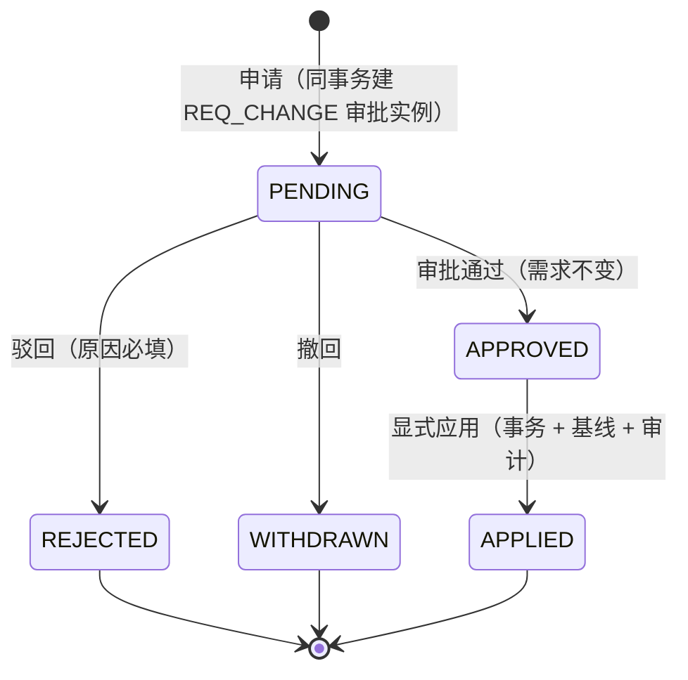

<!-- meta: summary="新增需求变更单子流程：申请→影响评估→两级审批→显式应用并留 before/after 基线，收口已入池需求的直接改内容，锁定版本下可变更但全程留痕。" -->
基线依赖：docs/teamflow/20261123-r39-automation-rule-engine（自动化规则引擎的字段变更事件、审计口径与 8 项门禁不得回归）

> **既有行为变化（不推翻任何既有 AC 的验收口径）**：`PUT /requirements/{id}` 在「已入池」之后不再接受 CONTENT/DAYS/RELEASE/PARENT 四类字段的直接修改，改为 409 `CHANGE_REQUIRED` 引导变更单；早期状态（AC-12 的逐类型表）保持直改。原「直改 + 一条 UPDATE 审计」的口径被收紧，这也是本需求存在的前提。

# 需求变更单（r40）

## 1. 背景与目标

### 1.1 现状（已核对代码）

- 改需求只有 `PUT/PATCH /api/req/requirements/{id}` 一条路：整包覆盖，写一条 `UPDATE` 审计，没有结构化 before/after。谁改了哪个字段、为什么改，只能从审计的自由文本里猜。
- 版本进入 `LOCKED/PUBLISHED` 后，版本侧动作（加/减成员、编辑版本、推进状态）一律 409 `RELEASE_LOCKED`（`ReleaseService.requireEditable` 只放行 `PLAN`），只能线下协调。
- **事实校正**：当前 `PUT /requirements/{id}` 本身并不检查版本锁（`requireWritable` 只拦终态），所以"锁定后改需求"在代码里的真实入口是版本成员增减；内容字段反而可以被静默改掉，且不触发任何版本侧校验。这比"改不了"更危险——冻结的版本里数据仍会变。
- 人天改动会让已通过的工时评估单变成 `STALE`，但这是读时派生，改动当下没有任何提示；影响几个子需求、是否波及已通过的发布单准入，也无处可看。
- 审批引擎已有 5 类单据与完整审批中心（待办/已办/加签/减签/驳回必填原因/撤回），但没有任何"变更"类单据。

### 1.2 目标

一句话：**把"改需求"从一次 PUT 变成一张可评估、可审批、可应用、可追溯的变更单，并在应用时留下不可篡改的 before/after 基线。**

可度量的结果：

1. 已入池需求的 CONTENT/DAYS/RELEASE/PARENT 变更 **100% 经变更单生效**；直接 PUT 命中即 409，负向用例可复现。
2. 影响评估中的"是否转 STALE / 受影响发布单"与 apply 后的实际结果 **逐项一致**，预测偏差 0。
3. 版本处于 `LOCKED/PUBLISHED` 时，每一次经变更单的改动都能按 `CHANGE_AFTER_RELEASE_LOCK` 审计查到，且 detail 带 `changeId` 与 `releaseId`。
4. 驳回/撤回/未审批/未应用的变更单对需求 **零副作用**（逐字段比对）。
5. 既有 8 项门禁一条不降；变更应用后 r39 的"字段变更"自动化规则仍恰好命中一次，不重不漏。

### 1.3 一句话边界

本轮只做"变更单"这一条竖切；**不做**变更批量、回滚到历史版本、子需求级联变更的自动审批（这三项分别留给需求池运营轮与需求基线轮）。

## 2. 角色与用户故事

| 角色 | 在本流程中的职责 |
|---|---|
| 产品经理 PRODUCT | 发起变更、查看影响、应用变更（域内） |
| 域负责人 DOMAIN_OWNER | 审批变更（第二级） |
| PMO | 审批兜底、跨域查看变更历史、审计追溯 |
| 研发 DEV | 对已入池 RD 需求发起"人天/父需求"类变更，应用已批变更 |
| 测试/厂商 | 只读或无入口；不得发起、不得应用 |
| 审计/管理层 | 按需求/单号/动作查 before/after 与锁定版本留痕 |

### US-1（P0）我要把一次需求改动提成变更单，并在提交前看清它会影响什么

作为产品经理，我在需求详情改标题、人天、版本或父需求时，不再直接落库，而是填原因、看影响、提交审批。

- **AC-1（迁移与表结构）**：新增 Flyway `V16__requirement_change.sql`，只建 `req_change` 与 `req_change_item` 两表，列名与语义完全按 §3.1；索引至少覆盖 `(tenant_id, requirement_id, created_at)` 与 `(tenant_id, status)`，`req_change_item` 主键 `(change_id, field)`。V1–V15 文件与校验和不变；空库与已有库各跑一次迁移均成功，**二次启动 schema 无变更**，迁移后 `req_change` 行数为 0（不回填、不改写既有需求）。
- **AC-2（创建校验）**：`POST /api/req/requirements/{id}/changes` 接收 `{changeType, reason, patch}`。`changeType` 只接受 `CONTENT/DAYS/RELEASE/PARENT`；`patch` 为空、含白名单外字段、或字段不属于该 `changeType` → **400 `CHANGE_FIELD_NOT_ALLOWED`**，detail 含 `{changeType, field, allowedFields}`；`reason` 缺失或全空白 → **400 `REASON_REQUIRED`**；patch 全部字段与当前值相同 → **400 `VALIDATION_FAILED`（"没有任何字段变化"）**；未知需求 → 404，越权 → 403（与需求详情同口径）。成功返回 2xx，body 含 `{id, status:"PENDING", instanceId, impact}`，且 `req_change` 与审批实例**同事务**落库：任一步失败两者都不留痕。
- **AC-3（影响快照契约）**：创建时计算并冻结 `impact_json`，顶层键固定为 `fields[] / children{count} / release{...} / targetRelease{...} / days{...} / admission{...} / postLock{...} / frozenAt`，缺数据用 `null` 或空数组而**不得缺键**；其中 `fields[]` 为 `{field,before,after}`；`days` 含 `{before,after,delta,estimateStatus,approvedDays,deltaRatio,becomesStale}`；`admission.passedOrderCodes[]` 列出覆盖该需求且准入快照全 PASS 的发布单号；`postLock.value` 与 `lockedReleaseIds[]` 标注冻结版本。创建后他人再改需求/版本，**已提交的 impact 不重算**（GET 原样返回），保证审批人看到的是提交那一刻的事实。
- **AC-4（第 6 类审批单据）**：审批实例 `biz_type=REQ_CHANGE`、`biz_id=changeId`，`instance_id` 回填到变更单；初始化后 `wf_definition` 存在 `REQ_CHANGE / ANY / 0` 的默认发布版，节点为**串行两级「产品经理 → 域负责人」**（审批人分别按 `PRODUCT`、`DOMAIN_OWNER` 解析），可在流程定义页改版或按需求类型/域绑定覆盖；改版后新单走新版本、在途单按启动版本走完。审批中心的待办/已办摘要显示「需求变更 · `<需求编号>` · `<类型>` · `<字段数> 项」，待办可直接打开变更详情。审批人解析为空 → **409 `APPROVAL_UNAVAILABLE`**，变更单与审批实例都不落库。

### US-2（P0）我审批的是一张"通过但还没生效"的单据，而不是一次静默改库

作为域负责人，我要在审批中心看到变更的前后值与影响，通过后由申请人显式应用；驳回必须写原因。

- **AC-5（结果映射）**：审批通过 → 变更单 `APPROVED`，**需求字段逐字段保持不变**（此时 apply 之前读需求仍是旧值）；驳回（原因必填，空原因 400 `REASON_REQUIRED`）→ `REJECTED`，需求不变，驳回原因在审批历史可查；撤回 → `WITHDRAWN`，需求不变；非法状态迁移（如对 `APPLIED` 再审批回调）返回 409 且不写任何行。`APPROVED` 的变更单在列表与详情中必须显示「已通过 · 待应用」，不得显示为「已生效」。
- **AC-6（并发与冲突）**：同一需求允许同时存在多张 `PENDING` 变更单。apply 时逐字段比对 `before_json` 与当前值，任一字段不一致 → **409 `CHANGE_CONFLICT`**，detail 含 `{field, expected, actual}`，**整体不写**（不得部分应用）；前端需把冲突字段提示给用户并引导重新发起。两张单改不同字段时可先后应用成功。

### US-3（P0）我要把已批的变更一次性应用，并确保失败就什么都不变

作为申请人，我点「应用」后要么全部生效并留基线，要么全部回滚。

- **AC-7（应用成功路径）**：`POST /api/req/changes/{changeId}/apply` 在**一个事务**内完成四件事：按 `after_json` 写需求字段；写 `req_change_item`（每个实际变化字段恰 1 行，含 before/after）；写审计 `REQUIREMENT_CHANGE_APPLIED`（含 changeId、字段清单、应用人）；变更单置 `APPLIED` 并写 `applied_at/applied_by`。成功后需求详情立刻返回新值，`req_change_item` 行数 = `fields[]` 长度，审计恰 1 条。并发两次 apply 只允许一次成功（第二次 409 `CHANGE_ALREADY_APPLIED`），审计只有 1 条、items 不重复。
- **AC-8（应用负向）**：`PENDING/REJECTED/WITHDRAWN` → **409 `CHANGE_NOT_APPROVED`**（detail 含当前 status）；`APPLIED` → **409 `CHANGE_ALREADY_APPLIED`**（detail 含 appliedAt）；无权 → 403；不存在 → 404；需求已关闭（终态）→ 沿用既有 **400 `VALIDATION_FAILED`（"需求已关闭，不可修改"）**。以上任一失败，需求字段、`req_change_item`、审计、变更单状态均零变化。
- **AC-9（人天与评估单 STALE）**：DAYS 变更应用后，若该需求存在 `APPROVED` 工时评估单，且 `|after − approved| / approved > 20%`（严格大于，含上浮与下调两个方向）→ 评估单状态变为 `STALE`，`schedule/start_dev` 重新 409 `ESTIMATE_NOT_APPROVED`；**恰好 20% 不转**；无 `APPROVED` 评估单时不转 STALE，apply 仍成功。创建时 `impact.days.becomesStale` 的预测必须与 apply 后实际状态一致（同一阈值公式），且 `deltaRatio` 与页面展示的百分比可复算。
- **AC-10（锁定/已发布版本下仍可变更）**：需求所属版本为 `LOCKED` 或 `PUBLISHED` 时，四类变更的 apply **仍成功**（不得因 `releaseLocked` 被拦），且额外写一条审计 `CHANGE_AFTER_RELEASE_LOCK`，detail 含 `changeId`、`lockedReleaseIds[]`、各版本 `status`；需求字段按 after 生效。RELEASE 变更应用后 `requirement.release_id` 与 `release_requirement` 关联行必须一致（旧行删除、新行插入，恰一行），且同样打锁标记。目标版本在 apply 时已 `CANCELLED` → 400 `VALIDATION_FAILED`（"目标版本已取消"），零副作用。`PLAN` 状态版本应用**不**写 `CHANGE_AFTER_RELEASE_LOCK`（避免审计噪音）。
- **AC-11（领域规则前置）**：父子层级（BUS→PDR→RD）、环、父需求人天只读、0.5 天精度、标题/优先级/日期合法性、目标版本可见且非 `CANCELLED` 等规则，在**创建时**即校验并返回与现有 PUT **同码同结构**的 400；apply 时再校验一次（树可能已变），不满足则 400/409 `CHANGE_CONFLICT` 且零副作用。典型必须前置拦住的例子：父需求改人天 → 400 `PARENT_DAYS_READONLY`；PDR 挂 RD 父 → 400 `INVALID_PARENT`；`estimateDays=0.25` → 400 `INVALID_DAY_PRECISION`。

### US-4（P0）已入池的需求不能再被直接改掉，但早期编辑不要被审批拖慢

作为产品经理，需求刚提报/待分析时仍可直接编辑；一旦入池，编辑入口变成「发起变更」。

- **AC-12（PUT 收口）**：`PUT/PATCH /requirements/{id}` 命中 CONTENT（title/description/priority/expectedDeliveryDate）、DAYS（estimateDays）、RELEASE（releaseId）、PARENT（parentId）中任一字段**且值与当前不同** → **409 `CHANGE_REQUIRED`**，detail 含 `{changeEndpoint:"/api/req/requirements/{id}/changes", fields:[...]}`；只改 `domainIds`/`sonarKey` 等非四类字段仍可直改；传相同值视为无变化，不拦。逐类型"早期可直改"状态：BUS `SUBMITTED/APPROVING/PENDING_REVIEW`、PDR `PENDING_ANALYSIS`、RD `TODO`（默认，见 §11 Q3）；其余状态（含 BUS `POOLED/CLOSED`、PDR `SCHEDULED/IN_DEV/DELIVERED/ACCEPTED_CLOSED`、RD `IN_DEV` 及以后）一律走变更单。直接改 status 仍被拒（唯一入口是流转动作/审批回调），不受本 AC 影响。
- **AC-13（编辑表单收口体验）**：需求详情编辑态下，命中四类字段且状态已过早期 → 输入控件**只读**并显示「需发起变更」；顶部提供「发起变更」按钮（无权限时禁用并给原因）。若仍从旧入口/直接请求拿到 409 `CHANGE_REQUIRED`，页面须展示一条可操作提示（含「发起变更」），点击后打开新建抽屉并预填被拦字段，**不得只弹一句错误就结束**。

### US-5（P0）我要能按需求查变更历史，也要能按单号看完整的前后对照

- **AC-14（查询接口）**：`GET /api/req/requirements/{id}/changes?page=&size=`（默认 1/20，size≤100），按 `created_at` 倒序，可选 `status` 过滤；每项含 `{id, changeType, status, reason, createdBy, createdAt, appliedAt, impactSummary{children, daysDelta, becomesStale, releaseLocked, affectedOrderCount}}`，并返回 `total/page/size`。`GET /api/req/changes/{id}` 返回 `{id, requirement{id,code,title,status}, changeType, status, reason, before, after, items[], impact, instanceId, appliedAt, appliedBy, createdBy, createdAt}`；关联审批进度走既有 `GET /approvals/instances/{id}`。越权/跨租户与需求详情同口径（403 或 404，不泄露存在性），不存在 404。

### US-6（P0）权限与审计必须能回答"谁在什么时候改了什么"

- **AC-15（权限与动作码）**：新增 `req.action.change_request`（依赖 `req:split`，产品经理/域负责人）与 `req.action.change_apply`（依赖 `req:deliver` 且 `req:split`，任一可达即满足"研发或产品经理"）两个动作码，登记进 `ActionRegistry` 与 `RequirementActionMatrix`，路由用既有声明式鉴权收口（`PermissionRouteTable` 的 `action()` 规则），**无裸路径**；审批权限按流程定义，不受这两个动作码影响。厂商账号对两个写接口均 403 且零写入；无 `req:split` 的研发可申请受限（403），但可应用（`req:deliver`）；测试账号两接口均 403。详见 §11 Q5 的替代方案。
- **AC-16（审计与事件同源）**：每次创建写 1 条 `CHANGE_REQUESTED`，每次 apply 写 1 条 `REQUIREMENT_CHANGE_APPLIED`，锁定版本 apply 额外写 1 条 `CHANGE_AFTER_RELEASE_LOCK`；detail 含 `changeId`、字段清单与必要的前后摘要，不落敏感内容；审计可按 action/需求/单号查到，且与 `req_change_item` 能还原每个字段变化。**同时**：apply 必须以既有 `UPDATE` 的字段变更事件口径发布事件（每个实际变化字段恰 1 条），r39 的"字段变更"规则照常命中——创建一条仅监听 `title` 的规则后应用一次标题变更，恰 1 条事件、1 次 run、1 条通知；不得因新增 `REQUIREMENT_CHANGE_APPLIED` 再补一条重复事件。

### US-7（P0）前端要让我在一个地方看完变更、影响和审批进度

- **AC-17（变更 Tab 与新建抽屉）**：需求详情新增第 10 个 Tab「变更」，标签带 `PENDING` 数量角标；列表列含状态（待审批/已通过·待应用/已应用/已驳回/已撤回）、类型、原因摘要、影响摘要（子需求数 · 人天 Δ · 是否将 STALE · 版本状态）、申请人、时间；空态给「暂无变更，发起变更」。点「发起变更」打开四步抽屉：①选类型 ②填原因（必填，≤500 字）③改字段（按类型只渲染白名单字段，实时显示 before→after）④影响预览（必含：子需求数、版本状态/是否锁定、人天 Δ 与 20% 阈值、评估单是否将 STALE、受影响发布单数）→ 提交审批。提交中按钮防重复点击；成功后关闭抽屉、刷新列表与详情并提示「已提交审批，尚未生效」；400/409 给字段级错误并保留已填内容。
- **AC-18（变更详情页）**：新增深链路由 `/requirements/:id/changes/:changeId`（`meta.pageCode="req.pool"`，**不新增菜单码与授权格**）。页面含：状态横幅（`APPROVED` 明示「审批已通过，尚未应用」；`APPLIED` 显示应用人与时间；`REJECTED` 显示驳回原因）；before/after 对照表（仅列变化字段，逐行前后值；人天行展示 `before → after（+X%，阈值 ±20%，将/已转 STALE）`）；影响评估卡（子需求/版本/发布单/锁定标记）；审批进度（复用审批时间线，含加签/减签记录）；「应用变更」按钮**仅在 `APPROVED` 且有权限时出现**，点击弹二次确认列出将写字段，成功后页面与需求详情同步刷新。深链刷新可达；无页面权限 403；应用冲突（409 `CHANGE_CONFLICT`）时高亮冲突字段。

### US-8（P0/P1）交付必须可复跑、可回归、可审计

- **AC-19（change-verify）**：新增 `scripts/change-verify.sh`，`PASS==TOTAL` 守卫、至少 **14 条**断言、分 6 段（迁移与结构 / 申请与影响 / 审批映射 / 应用正负 / 人天与锁 / 收口与审计查询），两次连跑结果一致，测试数据带 `RUN_TAG` 且结束清理残留为 0；必须覆盖：未审批 apply 409、重复 apply 409、非白名单字段 400、锁定版本下直接 PUT 409 `CHANGE_REQUIRED`、人天偏差 >20% 转 STALE、驳回后逐字段不变、审计与变更历史可查。同时提供 `make change-verify` 独立目标并接入 `make test`（`scripts/test-all.sh`），失败信息给出「哪一项 + 怎么修」，不得用 sleep 掩盖未就绪。
- **AC-20（既有门禁不降）**：`platform-verify ≥194`、`negative ≥130`、`access ≥206`、`rbac ≥113`、`demo-reset 80/80`（连跑两次）、`release-flow-verify ≥44`、`automation-verify ≥40`、`gate-order ≥20`、`lint ≥22`、`unit ≥447`（只增）；r39 演示的通知数仍恰 4，规则/事件计数不变；web build 0 error。
- **AC-21（文档与交付卫生，P1）**：更新 `docs/teamflow/DELIVERED-MODULES.md` 台账（r40 一行：模块、验证脚本、结果、提交）；在 `docs/teamflow/REQUIREMENT-FLOW.md` 补「变更入口」一节（PUT 409 → 变更单 → 审批 → 应用）；新增 `docs/teamflow/CHANGE-REQUEST-FLOW.md`（谁申请→影响评估→审批→应用→基线，含状态机、角色/权限矩阵、错误码表、impact 字段说明、本轮不做回滚）。`docs/teamflow/memory.md` 仅当产生新团队约定时替换同主题行，不追加流水账。分支 `feat/req-change-request` 上提交，提交信息含 runId 与任务夹路径；不新增 pom/package.json/lock 改动；V16 是唯一新增迁移；`.gitignore` 复核（`target/`、`node_modules/`、`dist/`、`.env*`、IDE、`logs/`、`*.xlsx/*.csv` 已覆盖，本轮如产生新工具产物再补，不得忽略 `*.sql` 与验收截图）。

## 3. 产品契约

### 3.1 数据模型（V16）

`req_change`：`id, tenant_id, requirement_id, change_type, status, reason, before_json, after_json, impact_json, instance_id, applied_at, applied_by, created_at, created_by`。`change_type ∈ {CONTENT, DAYS, RELEASE, PARENT}`；`status ∈ {PENDING, APPROVED, REJECTED, APPLIED, WITHDRAWN}`。

`req_change_item`：`change_id, field, before_value, after_value`，主键 `(change_id, field)`；**只在 apply 成功时写入**（驳回/撤回/待审批不写 items，避免"看起来改过"）。

`before_json` 是提交时刻**全量可变更字段**的快照；`after_json` 是 patch 合并后的同结构快照；两者都只含白名单字段，不存整行、不存敏感列。`impact_json` 见 AC-3。审批实例复用 `wf_instance/wf_task/wf_history`，不新建审批表；驳回原因从审批历史读取，`req_change` 不新增 `reject_reason` 列。

### 3.2 字段白名单

| changeType | 允许 patch 字段 | 说明 |
|---|---|---|
| CONTENT | `title, description, priority, expectedDeliveryDate` | 至少一项且必须产生变化 |
| DAYS | `estimateDays` | 0.5 天精度；父需求只读（预校验即拒） |
| RELEASE | `releaseId`（数字或 `null`） | `null` = 移出当前版本；目标版本不可见/已取消 → 400 |
| PARENT | `parentId`（数字或 `null`） | `null` = 升为顶级；层级链与环在创建时校验 |

### 3.3 接口

| 方法 | 路径 | 说明 |
|---|---|---|
| POST | `/api/req/requirements/{id}/changes` | 创建变更单 + 审批实例（同事务） |
| GET | `/api/req/requirements/{id}/changes` | 分页列表（含影响摘要） |
| GET | `/api/req/changes/{id}` | 变更详情（before/after/items/impact/审批实例号） |
| POST | `/api/req/changes/{id}/apply` | 显式应用（仅 `APPROVED`） |

### 3.4 错误码

| 状态 | 错误码 | 触发 |
|---|---|---|
| 400 | `CHANGE_FIELD_NOT_ALLOWED` | 字段不在该类型白名单 |
| 400 | `REASON_REQUIRED` | 原因为空（复用既有码） |
| 400 | `VALIDATION_FAILED` | 无字段变化、标题/日期/精度/父链非法、目标版本已取消、需求已关闭 |
| 400 | `PARENT_DAYS_READONLY` / `INVALID_PARENT` / `INVALID_DAY_PRECISION` | 复用既有领域码 |
| 409 | `CHANGE_REQUIRED` | 已入池需求直接 PUT 四类字段；detail 带 `changeEndpoint` |
| 409 | `CHANGE_NOT_APPROVED` | 对未通过/驳回/撤回的单 apply |
| 409 | `CHANGE_ALREADY_APPLIED` | 重复 apply |
| 409 | `CHANGE_CONFLICT` | apply 时 before 与当前值不一致（他人已改） |
| 409 | `APPROVAL_UNAVAILABLE` | 审批人解析为空（复用既有码） |

## 4. 范围与非目标

**范围（本轮交付）**：V16 两表；申请/查询/应用三组接口；第 6 类审批单据与默认两级流程；影响评估；人天→评估单 STALE；锁定版本变更留痕；PUT 收口；权限与动作码；审计与字段变更事件；需求详情「变更」Tab、新建抽屉、变更详情页；change-verify 与文档台账。

**非目标（本轮明确不做）**：

- 变更批量（一次改多条需求）与批量审批。
- 变更回滚/需求历史版本对比（留需求基线轮）；本轮只保证 before/after 快照与 items 可还原**一次**变更。
- 子需求级联变更的自动审批；只在影响评估里给出受影响子需求**数量**。
- 变更草稿箱、定时生效、审批通过自动 apply。
- 独立的全局「变更中心」菜单（见 §11 Q6）；本轮变更单只从需求详情进入，深链可达。
- 需求池运营（打标/批量分配/看板）与需求基线（版本快照/差异对比），留后续两轮。

## 5. 反面目标（anti-goals / 反面目标）

> 以下不是"没做的功能"，而是**即使测试全绿、人也会判定失败**的结果。

1. **「审批通过」被当成「已经改了」**：审批通过的瞬间需求字段就变了，或详情页把 `APPROVED` 显示成"已变更/已生效"，导致基线里的 before 与线上数据对不上。可观察：`APPROVED` 后逐字段 GET 需求仍为旧值；未 apply 前页面上没有任何"已生效"文案、应用按钮也不出现。
2. **影响评估说谎**：抽屉里写"0 个子需求、不会 STALE、无发布单"，应用后实际有 3 个子需求、评估单转 STALE、发布单准入失效（或反过来预告 STALE 却没转）。可观察：把 `impact_json` 与 apply 后实际逐项比对，出现任一不一致即为失败。
3. **变更单变成绕过审批的侧门**：已入池需求仍能用 PUT 改标题/人天/版本/父需求，或未审批的单据能被 apply，或锁定版本下改动不留痕。可观察：负向用例应 409/403 的实际返回 2xx，或数据库出现未审批的字段变更。
4. **冻结版本里的改动事后无法解释**：apply 成功但审计里搜不到 `CHANGE_AFTER_RELEASE_LOCK`，或 detail 没有 `changeId/releaseId`，审计员无法回答"谁在冻结后改了什么"。可观察：按 `changeId` 查审计得到 0 行，或 detail 缺关键字段。
5. **「能提交、必失败」的变更单浪费两级审批**：父需求改人天、非法父子、已取消版本这类注定 apply 失败的请求，在创建时被放行并走完审批，最后 apply 才 400，需求仍错、审批人白忙。可观察：创建即 400，且审批中心查不到该单。

## 6. 交互流程摘要

1. 需求详情 → 编辑字段被拦（409 `CHANGE_REQUIRED`）或主动点「发起变更」→ 抽屉选类型、填原因、改字段。
2. 提交前实时展示影响：子需求数 / 当前版本状态与是否锁定 / 人天 Δ 与 STALE 预测 / 受影响发布单数。
3. 提交 → 变更单 `PENDING` + 审批实例；审批中心两级（产品经理 → 域负责人），可加签/减签/驳回/撤回。
4. 通过 → `APPROVED`「已通过 · 待应用」；驳回 → `REJECTED`；需求字段始终不动。
5. 申请人在变更详情点「应用」→ 二次确认 → 事务内写字段 + items + 审计；版本锁定则额外 `CHANGE_AFTER_RELEASE_LOCK`；人天越 20% 则评估单读时转 `STALE`。
6. 应用后列表/详情显示 `APPLIED` 与前后对照；审计与自动化事件同步可查。

## 7. 优先级与 AC 索引

| AC | 主题 | 优先级 | 主要验证 |
|---|---|---|---|
| AC-1 | V16 两表、V1–V15 不变、幂等 | P0 | change-verify s1 + Flyway 二次启动 |
| AC-2 | 创建校验/白名单/同事务 | P0 | change-verify s2 |
| AC-3 | 影响快照契约与冻结语义 | P0 | change-verify s2 + jq 键断言 |
| AC-4 | 第 6 类单据与默认两级流程 | P0 | change-verify s2/s3 + 审批中心 |
| AC-5 | 通过未生效/驳回/撤回映射 | P0 | change-verify s3 |
| AC-6 | 并发多单与冲突 409 | P0 | change-verify s3 + 并发用例 |
| AC-7 | 应用事务、items、审计、幂等 | P0 | change-verify s4 |
| AC-8 | 应用负向与零副作用 | P0 | change-verify s4 |
| AC-9 | 人天 ±20% 与 STALE 预测=实际 | P0 | change-verify s5（含边界 20%） |
| AC-10 | 锁定/发布版本应用与审计 | P0 | change-verify s5 |
| AC-11 | 领域规则前置校验 | P0 | change-verify s2（错误码同源） |
| AC-12 | PUT 四类字段 409 与逐类型早期态 | P0 | change-verify s6 + negative |
| AC-13 | 表单只读与 409 一键引导 | P0 | 前端组件/E2E + 手工验收 |
| AC-14 | 列表/详情查询契约与越权 | P0 | change-verify s6 |
| AC-15 | 两个动作码与权限矩阵 | P0 | change-verify s6 + access/rbac |
| AC-16 | 审计 + r39 字段变更事件 | P0 | change-verify s6 + automation-verify |
| AC-17 | 变更 Tab 与四步抽屉 | P0 | 浏览器 E2E + 截图 |
| AC-18 | 变更详情页与 apply 按钮时机 | P0 | 浏览器 E2E + 截图 |
| AC-19 | change-verify ≥14 条、接入 make test | P0 | 脚本两次连跑 |
| AC-20 | 8 项既有门禁不降 | P0 | 全量 `make test` |
| AC-21 | 文档台账、流程文档、git 卫生 | P1 | 文档 diff 审查 |

## 8. 依赖与风险

**依赖**：

- r39 审计 outbox 与 `AutomationEventMapper` 的 `UPDATE` 字段事件口径（AC-16 必须复用，不能另起一套）。
- r26 工时评估单的六态与 `STALE` 读时派生（AC-9 不新增写路径）。
- 审批引擎 5 类单据、`StartApproval` 与 `DocumentSummaryProvider`（AC-4 新增第 6 类与摘要实现）。
- 版本成员关系 `requirement.release_id` + `release_requirement`（AC-10 双写一致性）。
- `PermissionRouteTable` + `ActionRegistry` + RBAC 启动预置（AC-15 新动作码由预置自愈，不写权限迁移）。

**风险与对策**：

- **审批通过到应用之间的窗口**：数据仍是旧的，但用户以为已改 → 详情页显示"有 N 张已通过待应用变更"横幅（AC-17/18），列表状态词固定为「已通过 · 待应用」。
- **影响评估成本**：子需求计数 + 发布单准入查询可能 N+1 → 创建接口按需求聚合查询，P95 目标 <300ms；超时不得静默降级为"无影响"，宁可 500。
- **并发 apply / 审批回调竞争**：状态更新用条件更新（`WHERE id=? AND status='APPROVED'`），受影响行数≠1 即 409；items 以 `(change_id, field)` 主键兜底。
- **RELEASE 变更绕过版本锁**：必须在同一事务维护 `release_requirement` 与 `requirement.release_id`，否则出现"单里移了、版本里还在"。
- **状态名类型差异**：`POOLED` 只存在于 BUS，PDR/RD 有各自的早期态（AC-12 用逐类型表，禁止用"POOLED 及以后"一把尺）。
- **权限口径**：PRODUCT 对 `req:deliver` 是 DENY、对 `req:split` 是 RESTRICTED，若 apply 动作只挂 `req:deliver`，产品经理将无法应用（直接违背需求）→ AC-15 要求双依赖，或用 §11 Q5 的独立权限码。
- **审计与事件重复**：若把 apply 实现成"再走一次普通 update"，可能出现 `UPDATE` + `REQUIREMENT_CHANGE_APPLIED` 两条审计并触发两轮自动化 → AC-16 明确"每字段恰一条事件、APPLIED 恰一条审计"。
- **演示回归**：r39 demo 的通知数恰 4、demo-reset 80 步，任何事件映射改动都可能改变计数 → AC-20 连跑两次。

## 9. 里程碑建议

| 里程碑 | 内容 | 覆盖 AC | 出口 |
|---|---|---|---|
| M1 数据与申请 | V16、变更单领域服务、影响评估、创建/查询、第 6 类单据与默认流程 | AC-1..4, 11, 14 | 迁移幂等、创建负向全绿、审批中心可见待办 |
| M2 审批与应用 | 回调映射、apply 事务、冲突、人天 STALE、锁定审计、撤回 | AC-5..10 | 未审批/重复/冲突/锁定用例全绿 |
| M3 收口与权限 | PUT 409、动作码、路由、审计与事件 | AC-12, 15, 16 | negative/access/rbac 不降，事件恰一次 |
| M4 前端 | 变更 Tab、四步抽屉、变更详情页、409 引导 | AC-13, 17, 18 | 浏览器 E2E + 截图 |
| M5 验证与交付 | change-verify、全量门禁、文档、提交 | AC-19..21 | `PASS==TOTAL`、全量 `make test` 绿、台账更新 |

## 10. 工程约束

- **分支**：已在 `feat/req-change-request`；开工前后不新建、不切换分支，所有改造提交在该分支。
- **未提交改动处理**：当前唯一未提交项是 `docs/teamflow/20261123-r40-req-change-order/`（含本 PRD 与 meta.json）。开发阶段不 stash、不回滚，随功能提交一并纳入；不得把任务夹拆成单独提交。
- **提交信息**：包含 runId `tf-mwt1f266-4e4y2h` 与任务夹路径 `docs/teamflow/20261123-r40-req-change-order/`，例如 `feat(req): 需求变更单闭环（申请→审批→应用→基线） [tf-mwt1f266-4e4y2h] docs/teamflow/20261123-r40-req-change-order`。
- **迁移纪律**：只新增 `V16__requirement_change.sql`；V1–V15 不得改动（校验和不变）；`pom.xml`、`web/package.json`、lock 文件 diff 必须为空（如需新依赖，先回产品确认）。
- **`.gitignore` 复核（开发阶段动作）**：现有规则已覆盖 `target/`、`node_modules/`、`dist/`、`.vite/`、`.pnpm-store/`、`.env*`、IDE、`logs/`、`*.xlsx/*.csv`、`*.log`、`.nacos/`；本轮若 change-verify 产生新缓存/导出文件，按同类追加一条并写注释，**不得**新增忽略 `*.sql`（V16 是迁移）、`docs/teamflow/**/evidence/*.png`（验收证据必须入库）。提交前 `git status --porcelain` 只允许出现预期文件。
- **脚本纪律**：`scripts/change-verify.sh` 是唯一验证入口，`make change-verify` 薄封装；`scripts/test-all.sh` 接入时机在平台栈拉起且 seed 完成后；失败必须打印「哪一项 + 怎么修」，禁止用固定 `sleep` 掩盖未就绪。
- **文档边界**：只写 `docs/teamflow/` 与任务夹；不写宿主 `docs/<role>/`；不在项目根散落日志；运行期临时文件放 `logs/teamflow/<runId>/`（run 结束由 host 归档）。

## 11. 假设与待澄清

> 每条都同时进入状态块 `openQuestions`（kind 与编号一一对应）。**默认值**是如果不额外指示、技术阶段将采用的方案。

- **Q1【fact】`@RequiresAction` 在仓库里零使用**：全部既有写端点都靠 `PermissionRouteTable` 的 `action()` 规则收口，注解虽存在且拦截器支持，但没有一处使用。默认沿用 route table + `ActionRegistry` 动作码（语义等价、与现有 lint/validator 口径一致），不引入第二套声明方式；若坚持按原话"补 `@RequiresAction`"，则在两个新端点上加注解、路由保留 page 兜底，并补一条 lint 断言两种声明不得同时缺省。
- **Q2【fact】"POOLED 及以后"只对 BUS 成立**：PDR 的早期态是 `PENDING_ANALYSIS`，RD 的初始态是 `TODO` 且没有更早状态。默认按 AC-12 的逐类型表判定"早期可直改"；若坚持字面只认 `POOLED`，PDR/RD 将永远可直改，变更单对研发需求形同虚设。
- **Q3【taste】RD 的 `TODO` 算不算"早期"**：默认**算**（RD 由父需求拆解而来，TODO 阶段多是补描述/修正人天，强制两级审批是空转）；从 `IN_DEV` 起必须走变更单。若选严格口径（RD 建单即需变更单），change-verify 需加一条"RD TODO 直接 PUT → 409"的负向，前端新建 RD 后也会立刻出现"发起变更"入口。
- **Q4【taste】并发变更策略**：默认**允许多张 `PENDING` 并存**，apply 时逐字段比对、冲突返回 409 `CHANGE_CONFLICT`，不自动合并；另一选择是"同一需求同时只允许 1 张待审批单"（第二张提交即 409），实现简单但会阻塞另一个字段的紧急变更。默认方案对用户更友好，代价是前端必须把冲突讲清楚。
- **Q5【taste】"应用"权限的口径**：需求写的是"`req:deliver` 或产品经理"，但矩阵里 PRODUCT 对 `req:deliver` 是 DENY、对 `req:split` 是 RESTRICTED。默认把 `req.action.change_apply` 同时挂 `req:deliver` + `req:split`（任一可达），这样 DEV/PM/PMO 可用；代价是拥有 `req:split` 的域负责人也能应用。更严的做法是新增 `req:change:apply` 权限码并单独配 PRODUCT=`ALLOW`（+权限矩阵行、+授权格数、+1 条迁移或预置改动）。
- **Q6【taste】变更详情的 IA**：默认走需求详情子路由 `/requirements/:id/changes/:changeId`（`pageCode=req.pool`，**不新增菜单码/授权格/导航项**）；另一选择是独立「变更中心」菜单（跨需求列表 + 详情，+1 菜单码、+11 角色格、导航 37→38），对 PMO 更友好但超出本轮范围。
- **Q7【fact】当前 PUT 不受版本锁约束**：`RELEASE_LOCKED` 只出现在版本成员增减/版本编辑/状态推进；需求内容字段现在可被静默改。默认不新增"PUT 检查 release 状态"的门（否则与"锁定下仍可经变更单应用"的诉求打架），锁定语义由 `impact.postLock` + apply 时的 `CHANGE_AFTER_RELEASE_LOCK` 审计表达。若产品原意是"锁定即冻结一切入口"，需要额外一道 release 检查并接受"先解锁再变更"的流程。
- **Q8【fact】apply 时需求已关闭**：默认沿用 `requireWritable` 的 **400 `VALIDATION_FAILED`**（"需求已关闭，不可修改"），不新增错误码；另一选择是新增 409 `CHANGE_NOT_APPLICABLE`，语义更准但需要前端映射与契约扩项。
- **Q9【fact】"已通过的发布单准入"如何定义**：默认只读列出覆盖该需求、且最近一次准入快照全部 PASS 的发布单号（`admission.passedOrderCodes`），**不自动重评、不阻断 apply**；需求只要求"标注影响"。若要求"人天变更后发布单必须重新准入/阻断应用"，属于新增门禁，本轮不做。

## 12. 验收口径

- 每条 AC 必须能被 `scripts/change-verify.sh`、既有门禁或明确的浏览器步骤复现；"界面看起来对"不算通过。
- `change-verify` 与既有 8 项门禁必须 `PASS==TOTAL`；任一项 FAIL 即整体不通过，不允许"已知失败"。
- 验收报告逐条给出：命令、关键响应（状态码/字段）、DB 计数或审计行、必要的截图（变更 Tab、四步抽屉影响预览、变更详情对照表、409 引导）。
