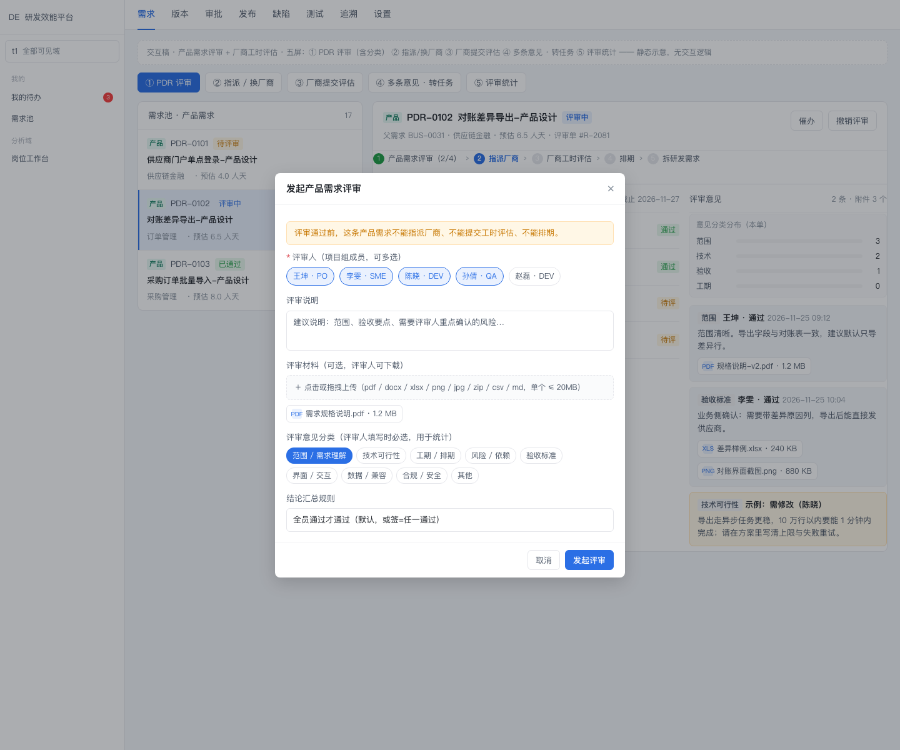
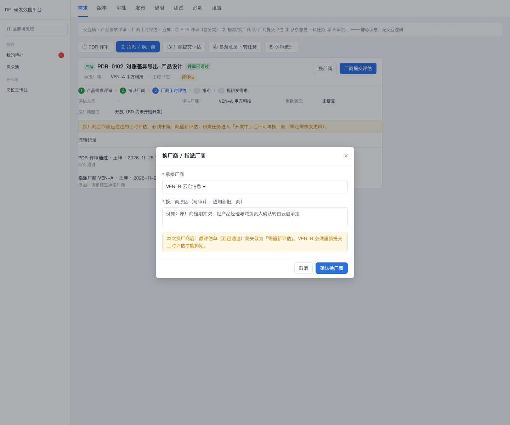
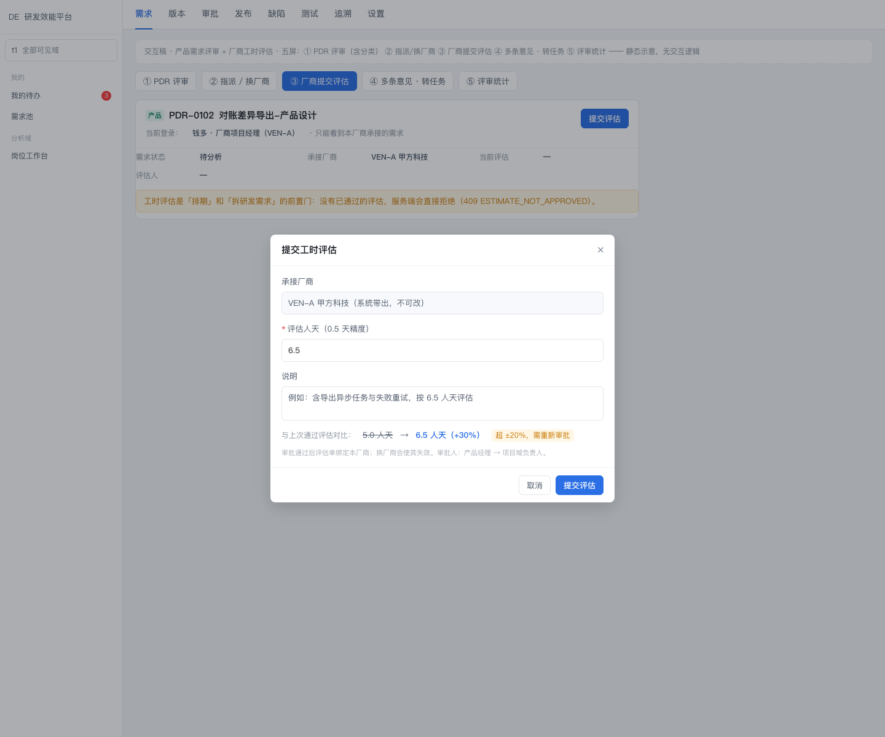
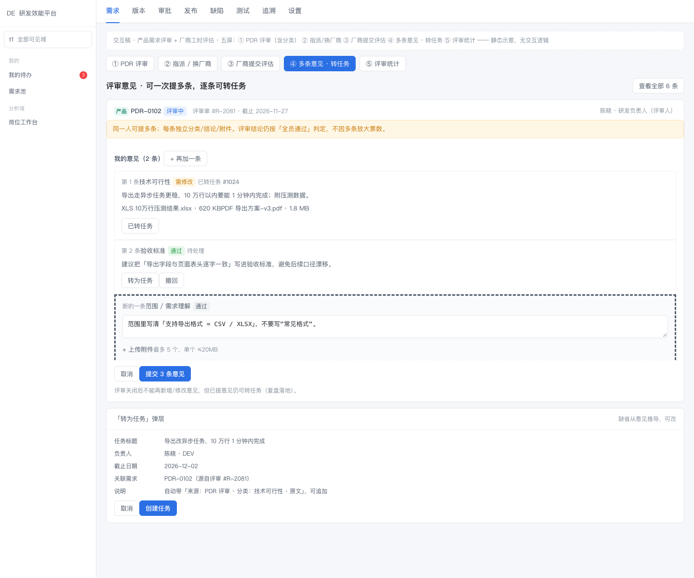
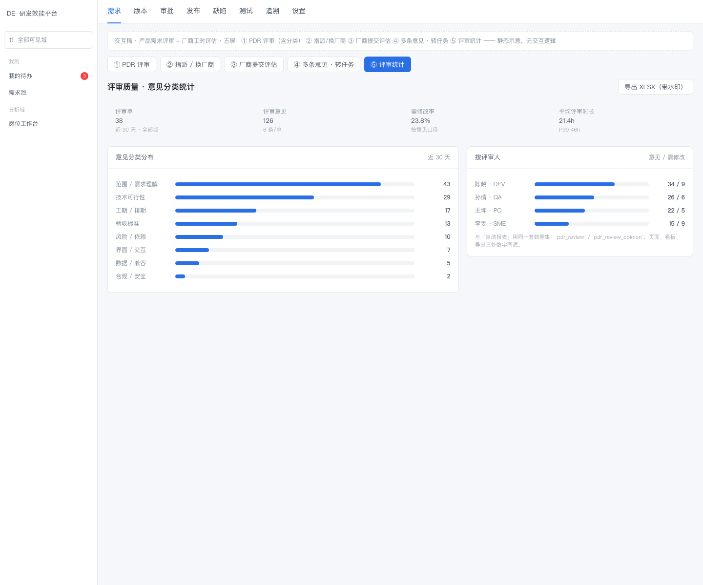

# 流程调整设计方案：产品需求评审 + 厂商工时评估

> **本文是什么**：给流水线 PRD 阶段的输入材料（不是最终 PRD）。含现状取证（精确到文件行）、目标流程、数据/接口/权限变更、交互稿、可执行验收口径、迁移与风险。
> **基线**：`main = f8dee2a`（2026-11-25）。取证方式=读代码 + 真跑接口，每条都带证据。
> **用户原话**（2026-11-25）：
> 1. 「工作量评估是由厂商做的，所以要先选择厂商后再评估工作量，再任务还没开始前，允许变更厂商」
> 2. 「产品需求也需要进行评审，要反馈评审意见，评审人员可以选择参与的项目组成员，大家各自发表评审意见」

## 1. 一句话目标

把产品需求（PDR）从「拆出来就评估排期」改成 **评审 → 选厂商 → 厂商评估 → 排期 → 拆 RD**，并把工时评估的所有权从内部挪到承接厂商（任务开始前可换厂商，换厂商即重评）。

## 2. 现状取证（改之前先确认现在长什么样）

| 能力 | 现状 | 证据 |
|---|---|---|
| 指派厂商 | 只校验「未终态」；写 `VENDOR_TRANSFER` 审计 + 通知；**没有任何状态门**，也不与工时评估联动 | `req-service/src/main/java/com/example/req/requirement/RequirementService.java:680-714` |
| 指派厂商的权限 | 动作码 `req.action.assign_vendor` → 功能码 `req:assign-vendor`；路由规则精确匹配 | `platform-contract/.../ActionRegistry.java:80`、`platform-common/.../PermissionRouteTable.java:139-140` |
| PDR 状态机 | `PENDING_ANALYSIS --schedule--> SCHEDULED --start_dev--> IN_DEV --deliver--> DELIVERED --accept--> ACCEPTED_CLOSED`，**没有评审态** | `platform-contract/.../StateTables.java:76-78` |
| 工时评估提交 | `POST /requirements/{id}/estimate` → 建第 5 类单据 `WBS_ESTIMATE`；权限是**服务层**判 `can("deliver")`（内部 PMO/研发），厂商账号无此档位 | `req-service/.../requirement/WbsEstimateService.java:92-141`、`:583-590` |
| 评估单与厂商 | **无绑定**：评估单文档里没有 vendor 字段，换厂商不会让评估失效 | 同上；`EstimateSnapshot`/`WbsEstimateViews` 无 vendor |
| 评估失效 | 只有「人天变动 >±20%」派生 `STALE`（r26） | `WbsEstimateService.STALE_THRESHOLD` |
| 产品需求评审 | **不存在**。仅业务需求有 `REQ_REVIEW`，且审批通过由回调自动推进 POOLED | `PlatformContract`/`StateTables.java:66-71`；`req-service/.../requirement/RequirementReviewCallback.java:26-30` |
| 审批引擎能力 | 支持 5 类单据、节点会签/或签（`MODE_ALL`/`MODE_ANY`）、审批人来源 `ROLE/USER/SUPERVISOR/DOMAIN_OWNER`，可复用来做「多人评审」 | `req-service/.../approval/WorkflowDefinition.java:27-28`、`ApproverResolver.java:18-78`、`ApprovalEngine.java:542` |
| 项目组 / 项目成员 | **全仓不存在**（`grep -rniE "project_member\|projectMember\|sys_project\|项目组"` 零命中） | 需新增，否则「评审人从项目组成员里选」没有数据来源 |
| 附件能力 | **已有通用附件基础设施**：`attachment` 表（`biz_type/biz_id/file_name/path/size/content_type/sha256/uploader_id`）+ `GET/POST/DELETE /attachments` + `/{id}/download`；限制 20MB、校验 bizId 归属、写 `ATTACH_DELETE` 审计 | `req-service/src/main/java/com/example/req/attachment/{AttachmentController,AttachmentService,AttachmentEntity}.java`；`AttachmentService.java:55`（20MB）、`:278-294`（bizType 白名单） |
| 附件业务类型 | 目前只支持 `REQ / DEFECT / TEST_PLAN / WIKI_PAGE` 四类；路由权限落 `page("req.pool","defect.list","test.cases","collab.wiki")` | `AttachmentService.java:278-294`、`PermissionRouteTable.java:393-394` |
| 迁移现状 | 最新 `V16__requirement_change.sql`，新增从 **V17** 起 | `req-service/src/main/resources/db/migration/` |

**一个容易踩的坑**：`POST /requirements/{id}/estimate` 在路由表里落到兜底规则 `^/requirements.*$ → page("req.pool","me.tasks")`（`PermissionRouteTable.java:163`），所以它**看起来**没有权限校验；真正的 403 来自服务层 `requireDeliverPermission`（`WbsEstimateService.java:583-590`）。改造时若要新增动作码，必须把精确规则插在这条兜底之前，否则会被页面权限放行。

## 3. 目标流程

### 3.1 PDR 段目标顺序

```
拆出产品需求(PDR, PENDING_ANALYSIS)
      │
      ▼
① 产品需求评审  项目组成员多人并行，各自 通过/需修改/驳回 + 意见
      │ 全部通过
      ▼
② 指派承接厂商  assign-vendor（此时才允许；换厂商窗口直到「任务开始」）
      │
      ▼
③ 厂商提交工时评估  评估人天 + 说明，评估单绑定 vendor_id
      │ 审批通过
      ▼
④ 排期 schedule → SCHEDULED
      │
      ▼
⑤ 拆研发需求 decompose → RD(TODO)
      │
      ▼
   现有 RD 链路（开始开发→任务→提测→测试结论→合入→完成→交付→验收）
```

### 3.2 状态与门禁对照

| 环节 | 现在 | 目标 | 违反时的错误码 |
|---|---|---|---|
| PDR 评审 | 无 | 未通过评审：不能指派厂商/评估/排期 | `409 PDR_REVIEW_REQUIRED`（detail: `reviewId?`, `required:"pdr_review"`） |
| 指派厂商 | 任何未终态 | 评审通过后；`IN_DEV` 之后不可换 | `409 VENDOR_LOCKED`（detail: `currentStatus`, `allowed:["TODO"]` 语义按类型给） |
| 工时评估 | 内部 PMO/研发提交 | **由承接厂商提交**（内部保留兜底权，见 §6 R4） | `409 VENDOR_NOT_ASSIGNED`（detail: `required:"assign_vendor"`） |
| 排期 | 需评估通过（r26） | 不变，额外要求厂商评估 | `409 ESTIMATE_NOT_APPROVED`（已有） |
| 换厂商 | 随时可换、评估不失效 | 换厂商 → 原评估单失效 → 必须新厂商重评 | 审计 `VENDOR_CHANGED`；评估派生 `STALE`（原因 `VENDOR_CHANGED`） |

### 3.3 厂商生命周期

```
未指派 ──assign-vendor(原因必填)──▶ 已指派(VENDOR_A)
                                        │
                    厂商提交评估 ──▶ 评估通过(绑定 VENDOR_A)
                                        │
     ┌──────────── 任务未开始（RD=TODO 且 PDR≠IN_DEV）────────────┐
     │  换厂商(原因必填) → 评估单失效(STALE/VENDOR_CHANGED) → 回「未评估」│
     └──────────────────────────────────────────────────────────┘
                                        │ 任务开始（RD IN_DEV / PDR IN_DEV）
                                        ▼
                                      锁定（换厂商 409 VENDOR_LOCKED，走需求变更单）
```

## 4. 数据模型变更

### 4.1 新增表

| 表 | 关键列 | 约束/索引 |
|---|---|---|
| `project` | `id, tenant_id, code, name, domain_id, owner_user_id, status(ACTIVE/ARCHIVED), created_at` | `uk(tenant_id, code)`；`idx(tenant_id, domain_id)` |
| `project_member` | `id, tenant_id, project_id, user_id, role_in_project(PO/PM/DEV/QA/SME), active, joined_at` | `uk(project_id, user_id)`；`idx(tenant_id, user_id)` |
| `pdr_review` | `id, tenant_id, requirement_id, project_id, instance_id, status(DRAFT/IN_REVIEW/PASSED/REJECTED/CANCELLED), conclusion, initiator_id, created_at, closed_at` | **`uk(requirement_id) where status='IN_REVIEW'`**（同一需求同时只允许 1 张在评）；`idx(tenant_id, status)` |
| `pdr_review_opinion` | `id, tenant_id, review_id, reviewer_id, seq(该评审人第几条), decision(PASS/NEED_CHANGE/REJECT), **category**, comment, **status(OPEN/TASKED/RESOLVED)**, **task_id**, created_at` | **不做 (review_id, reviewer_id) 唯一约束**（同一人可提多条）；`idx(review_id)`、`idx(tenant_id, category)`、`idx(task_id)` |

### 4.2 评审附件（复用既有附件表，不新增表）

评审意见要能带附件，**不新建表**，复用 `attachment`：

| 项 | 取值 |
|---|---|
| `biz_type` | 新增白名单值 `PDR_REVIEW`（`AttachmentService.normalizeType` 扩展） |
| `biz_id` | `pdr_review.id`（评审单级，不挂到单条意见上——意见与附件都在评审单下，读侧按人分组） |
| 可选扩展 | 若需要"附件属于某条意见"，加一列 `ref_id BIGINT NULL`（指向 `pdr_review_opinion.id`），缺省**不加**，先按评审单维度 |

> 路由权限沿用 `page("req.pool", …)`（`PermissionRouteTable.java:393-394`），上传的**归属校验**放在服务层（只允许本次评审的评审人/发起人在评审进行中上传）。

### 4.3 既有表增量

| 表 | 新增列 | 说明 |
|---|---|---|
| `requirement` | `project_id BIGINT NULL` | PDR 建议必填；存量 NULL 走回退规则；`idx(tenant_id, project_id)` |
| `wbs_estimate`（若评估单落独立表）或评估文档 | `vendor_id BIGINT NULL`、`participant_kind INTERNAL/VENDOR` | 存量回填 `vendor_id = requirement.assignee_vendor_id`；为空表示内部评估 |

> 若评估单以 JSON 文档存于审批实例（现状如此，`EstimateSnapshot`），则把 `vendor_id` 写进文档并在 `wbs_estimate` 汇总表加列以便查询/校验；两种存法都要在验收里断言「换厂商后读出来是 STALE」。

### 4.4 评审意见分类（便于统计）

意见必须带**一个**分类（单选，够统计且不逼用户做多标签判断）；分类走 `sys_dict` 字典而不是硬编码枚举，业务可自行增删：

| code | 中文 | 典型用法 |
|---|---|---|
| `RANGE` | 范围 / 需求理解 | 边界不清、漏场景、与父需求不一致 |
| `TECH` | 技术可行性 | 实现方案、性能、异步/批量、依赖能力 |
| `SCHEDULE` | 工期 / 排期 | 人天评估、排期冲突、依赖顺序 |
| `RISK` | 风险 / 依赖 | 外部系统、数据迁移、上线风险 |
| `ACCEPTANCE` | 验收标准 | 通过条件、测试口径、口径不一致 |
| `UI` | 界面 / 交互 | 页面流程、字段展示、状态可读性 |
| `DATA` | 数据 / 兼容 | 字段口径、历史数据、导入导出格式 |
| `COMPLIANCE` | 合规 / 安全 | 权限、脱敏、审计、水印 |
| `OTHER` | 其他 | 兜底（缺省值，允许但不鼓励） |

统计口径（三处同源，避免"页面一个数、报表另一个数"）：
- 意见数、各分类占比、需修改/驳回率（按意见、按评审单两种口径都要给）；
- 平均评审时长 = 评审单 `created_at → closed_at`（小时），以及 P90；
- 评审人维度：每人发起/参与/意见数/需修改比例。
- 维度表：`pdr_review`（评审单）、`pdr_review_opinion`（意见）作为新数据集进分析域，供 `/reports` 自助报表与看板直接取数（复用既有 `AnalyticsDatasets` 白名单机制，**不写第二套 SQL 引擎**）。

### 4.5 多条意见与「意见转任务」

**为什么允许多条**：一条评审意见通常只针对一个点（范围、性能、验收口径……），把它们塞进一段文字里，既无法分类统计，也无法逐条跟踪闭环。所以：

- 同一次评审、同一个人可以提 **N 条意见**（`seq` 递增，不设唯一约束），每条独立拥有 `category / decision / comment / 附件 / status`；
- **评审结论仍由评审单整体判定**（`MODE_ALL` 等），不因某人不通过而"每人只能一条"——多条意见属于"一个人提了几个问题"，不是"投了几票"；统计口径里"意见"与"评审单"分开算（见 4.4）。
- 每条意见有生命周期：`OPEN`（待处理）→ `TASKED`（已转任务）→ `RESOLVED`（任务完成/问题消除）；`decision=REJECT` 的意见可标 `RESOLVED` 结案，不必都转任务。

**意见转任务**（把评审结论变成可执行动作，闭环的关键）：

| 项 | 说明 |
|---|---|
| 端点 | `POST /pdr-reviews/{reviewId}/opinions/{opinionId}/to-task` |
| 请求 | `{assigneeId?, dueDate?, estimateHours?, title?, description?}`（都可选，缺省从意见推导） |
| 落库 | 复用交付域 `task` 表（`deliver-service`）：`title` 缺省取意见前 40 字、`description` 带「来源：PDR 评审 #reviewId · 分类 · 原文」、`requirementId` 挂该 PDR 的父 RD 或 PDR 本身（PDR 无任务归属时挂 PDR） |
| 回写 | `pdr_review_opinion.task_id` = 新任务 id、`status = TASKED`；写入 `audit_log`（`PDR_OPINION_TO_TASK`，detail 带 opinionId/taskId/category） |
| 限制 | 已转过的意见再转 → `409 OPINION_ALREADY_TASKED`（detail 带既有 `taskId`）；非本评审评审人且非产品经理 → `403 NOT_ALLOWED`；**评审结束后仍可转任务**（复盘落地属后续动作，不随评审关闭而禁止） |
| 可见性 | 任务继承 `ScopeSql` 行级隔离；厂商评审人转出的任务只能落在本厂商承接范围（越界 `403 OUT_OF_SCOPE`） |
| 统计 | `/pdr-reviews/stats` 增加 `taskedCount` 与「意见闭环率 = TASKED+RESOLVED / 全部意见」两个度量 |

## 5. 接口变更

### 5.1 新增

| 方法 | 路径 | 用途 | 备注 |
|---|---|---|---|
| `GET/POST` | `/projects`、`PUT /projects/{id}` | 项目维护 | 权限 `org:manage` |
| `GET/POST/DELETE` | `/projects/{id}/members` | 项目成员维护 | 同上 |
| `POST` | `/requirements/{id}/pdr-review` | 发起 PDR 评审：`{reviewerIds:[], note}` | 动作码 `req.action.pdr_review_start` |
| `POST` | `/pdr-reviews/{reviewId}/opinions` | 评审人提交意见：`{decision, **category**, comment}`（`category` 必填，非法值 400 `INVALID_CATEGORY`） | 动作码 `req.action.pdr_review_opinion` |
| `POST` | `/pdr-reviews/{reviewId}/conclude` | 汇总结论（**也可以全票后自动汇总**，见 §6 R2） | 动作码 `req.action.pdr_review_conclude` |
| `GET` | `/requirements/{id}/pdr-review` | 读评审单 + 意见列表 | 页面码 `req.pool` |
| `POST` | `/pdr-reviews/{reviewId}/opinions/{opinionId}/to-task` | 意见转任务（见 4.5），返回 `{taskId, taskCode}` | 动作码 `req.action.pdr_review_task` |
| `GET` | `/requirements/{id}/pdr-review/opinions` | 意见列表：支持 `?reviewerId&category&status&page&size`（多条意见分页） | 页面码 `req.pool` |
| `GET` | `/pdr-reviews/stats` | 意见分类统计：`?domainId&from&to&groupBy=CATEGORY\|REVIEWER\|DECISION` → 计数 / 占比 / 平均评审时长 | 页面码 `req.pool`（读） |
| `GET` | `/pdr-reviews/datasets` | 分析域数据集白名单元信息（`pdr_review`、`pdr_review_opinion`，含维度/度量） | 复用 `/reports/datasets` 机制 |

### 5.2 评审附件（复用 `/attachments`，不新增端点）

| 方法 | 路径 | 说明 |
|---|---|---|
| `POST` | `/attachments?bizType=PDR_REVIEW&bizId={reviewId}` | 评审人上传附件（multipart `file`）；仅 `IN_REVIEW` 期间、仅该评审的评审人/发起人 |
| `GET` | `/attachments?bizType=PDR_REVIEW&bizId={reviewId}` | 列附件（评审人、发起人、能看到该需求的角色） |
| `GET` | `/attachments/{id}/download` | 下载（走现有鉴权与范围校验） |
| `DELETE` | `/attachments/{id}` | 删除：仅上传者本人或产品经理，且评审未结束 |

### 5.3 变更

| 接口 | 变更 |
|---|---|
| `POST /requirements/{id}/assign-vendor` | 加状态门（评审通过才允许、IN_DEV 后 409）；换厂商时作废已通过评估单并通知新旧厂商 |
| `POST /requirements/{id}/estimate` | 要求「已指派厂商」（409 `VENDOR_NOT_ASSIGNED`）；允许厂商账号提交且仅限本厂商承接需求；评估文档写 `vendor_id` |
| `GET /requirements/{id}` | `view` 增加 `pdrReview{status, conclusion, opinions[]}`、`estimate.vendorId/vendorName` |

## 6. 服务端规则（可直接抄成 PRD 验收）

- **R1 顺序门**：PDR 未通过评审 → 指派厂商/评估/排期一律 409 `PDR_REVIEW_REQUIRED`；未指派厂商 → 评估 409 `VENDOR_NOT_ASSIGNED`；评估未通过 → 排期 409 `ESTIMATE_NOT_APPROVED`（已有）。
- **R2 评审结论与分类**：意见必须带 `category`（非法/缺失 → 400 `INVALID_CATEGORY`，`detail.allowed[]` 列可选值）；`MODE_ALL`（默认全员通过才算通过）；任一 `NEED_CHANGE`/`REJECT` → 评审 `REJECTED`，PDR 保持可编辑并记录意见；重新发起评审需新建单据（历史保留）。
- **R3 换厂商**：允许窗口 = RD 处于 `TODO` 且 PDR 未进 `IN_DEV`；换厂商 → 该需求 `APPROVED` 评估单派生 `STALE`（原因 `VENDOR_CHANGED`）→ 状态回到「待评估」；`IN_DEV` 之后 409 `VENDOR_LOCKED`；换厂商必须填原因，写 `VENDOR_CHANGED` 审计并通知新旧厂商。
- **R4 厂商评估**：厂商账号（`VENDOR_PM` 与厂商研发）可提交评估，且 `requirement.assignee_vendor_id == user.vendorId`，否则 `403 OUT_OF_SCOPE`；内部 PMO/研发**保留提交权**（缺省保留，便于兜底），但同样要求先指派厂商。
- **R5 幂等与并发**：同一需求同时只有 1 张 `IN_REVIEW` 评审单、1 张 `ACTIVE` 评估单；并发发起/重复提交用唯一约束 + 409 兜底；换厂商与提交评估加乐观锁（`version`）避免「换厂商后立刻被旧厂商提交评估」。
- **R7 评审附件**：`bizType=PDR_REVIEW` 时，服务层校验「调用者是本次评审的评审人或发起人」且「评审单状态 = IN_REVIEW」，否则 `403 NOT_REVIEWER` / `409 REVIEW_CLOSED`；上传沿用 20MB 上限与 `sha256`；类型白名单（缺省 `pdf/docx/xlsx/png/jpg/zip/csv/md`），非白名单 `415 UNSUPPORTED_MEDIA_TYPE`；**不落公开 URL**，下载一律过鉴权（越权 404，不泄露存在性）；评审结束后附件只读，删除 → 409 `REVIEW_CLOSED`。
- **R8 多条意见与转任务**：`POST .../opinions` 不做「同人唯一」校验，每次新建一条（`seq` 自动递增，可一次提交多条 `opinions[]`）；`to-task` 只能由本评审评审人/产品经理发起、每 opinion 只成功一次（`409 OPINION_ALREADY_TASKED`）、任务创建与 `task_id` 回写同事务、跨服务失败回滚并返回 `503 TASK_CREATE_UNAVAILABLE`；评审单关闭后 `to-task` 仍可用，但禁止再新增/修改意见（`409 REVIEW_CLOSED`）。
- **R6 审计**：`PDR_REVIEW_START` / `PDR_REVIEW_OPINION` / `PDR_REVIEW_REJECT` / `PDR_REVIEW_PASS` / `VENDOR_CHANGED` / `ESTIMATE_STALE_BY_VENDOR`，全部进动态流与追溯。

## 7. 权限与动作码

| 新增动作码 | 页面码 | 默认授予 | 说明 |
|---|---|---|---|
| `req.action.pdr_review_start` | `req.pool` | 产品经理、域负责人、PMO | 发起评审 |
| `req.action.pdr_review_opinion` | `req.pool` | 被选中的项目组成员（运行时校验）+ 产品经理 | 提交意见 |
| `req.action.pdr_review_conclude` | `req.pool` | 产品经理、域负责人 | 汇总/驳回 |
| `req.action.estimate_submit` | `req.pool` | `VENDOR_PM`、厂商研发、内部 PMO/研发 | 替代现在只认 `req:deliver` 的判定 |

路由表新增条目**必须插在 `^/requirements.*$` 兜底之前**（`PermissionRouteTable.java:163`），否则会被页面权限放行。

## 8. 前端交互（交互稿见 `prototype-pdr-review/index.html`）








0. **意见分类**：提交意见时先选分类（9 个 chip，单选，必填），意见卡左上角展示分类标签；评审 tab 顶部一行「分类分布」小条形（范围 3 / 技术 1 / 工期 2 …），点分类可过滤意见列表。
0.1 **多条意见**：提交意见区改成「意见列表」——点「+ 再加一条」逐条填（分类 chip + 结论 + 正文 + 附件），一次提交多条；已提意见卡片右侧有「转为任务」按钮（已转则显示 `TASKED · 任务 #123` 与链接），支持按分类/状态过滤。
0.2 **统计视图**：分析域「评审质量」看板卡：各分类意见数堆叠柱、需修改率、平均评审时长 P90、按评审人 Top N（复用 `MetricFormulas` 同源口径）。
0. **评审附件**：发起评审弹窗里可先挂「评审材料」；每位评审人提交意见时可附 1–5 个附件（截图里是「规格说明.pdf / 差异样例.xlsx」这类），意见卡下方展示附件 chip（文件名 + 大小 + 下载）；评审结束后 chip 变只读、无删除按钮。
1. **PDR 详情新增「评审」tab**：发起按钮 + 评审人选择（只能选项目组成员，多选）+ 说明；列表展示每人「通过/需修改/驳回 + 意见 + 时间」；顶部结论条（N/M 已评）。
2. **指派厂商弹窗改造**：加「换厂商会作废已通过的工时评估，需重新评估」的黄色提示；原因必填；`IN_DEV` 后按钮禁用并给原因。
3. **工时评估弹窗改造**：显示「承接厂商」徽标；厂商账号进入时默认本单位；非本厂商或无权限时按钮禁用 + 悬停原因（沿用 r25 的 `需要权限：<码>` 文案形态）。
4. **需求详情评估卡**：增加「评估厂商 / 评估人 / 评估时间」三行；`STALE` 时展示失效原因（人天变动 / 换厂商）。

## 9. 演示数据要求（`make platform-demo-reset` 后）

| 样例 | 期望 |
|---|---|
| 项目 | `DEMO-PROJ-1 供应链平台`，成员 5 人（产品经理/域负责人/研发/测试/厂商 PM） |
| PDR-1 | 待评审（评审单 IN_REVIEW，2/4 已评），带 2 个评审附件（`规格说明.pdf`、`差异样例.xlsx`）；已有 **6 条意见**（王坤 3 条：2 RANGE + 1 ACCEPTANCE；李雯 2 条：1 TECH + 1 DATA；陈晓 1 条 TECH/NEED_CHANGE），其中 1 条已转任务（`TASKED`，任务 #1024，`OPEN` 5 条） |
| PDR-2 | 评审通过、已指派 VEN-A、待提交评估 |
| PDR-3 | 评审通过、VEN-A 评估通过、已排期 |
| RD | 挂在 PDR-3 下，`TODO`（可用于演示换厂商 → 评估失效） |

## 10. 验收标准（可执行）

| # | 断言 | 期望 |
|---|---|---|
| A1 | 未指派厂商直接 `POST /estimate` | 409 `VENDOR_NOT_ASSIGNED` |
| A2 | 厂商 `vpm1` 对已指派 VEN-A 的 PDR 提交评估 | 201；`GET` 评估卡 `vendorName=VEN-A` |
| A3 | 换厂商（VEN-A→VEN-B）后读评估 | `status=STALE`、`reason=VENDOR_CHANGED`；审计有 `VENDOR_CHANGED`；新厂商重评 → 201 |
| A4 | RD 进入 `IN_DEV` 后换厂商 | 409 `VENDOR_LOCKED`，提示走变更单 |
| A5 | 厂商对**别家**厂商承接的需求提交评估 | 403 `OUT_OF_SCOPE` |
| B1 | 未通过评审直接指派厂商/评估/排期 | 409 `PDR_REVIEW_REQUIRED` |
| B2 | 4 名评审人：3 通过 1 需修改 | 评审 `REJECTED`；意见 4 条可见；PDR 可编辑 |
| B3 | 重新发起并 4 人全通过 | `PASSED`；此后指派厂商 200 |
| B4 | 评审人不在项目组 | 400 `REVIEWER_NOT_IN_PROJECT` |
| B5 | 项目组为空发起评审 | 按回退规则（产品经理+域负责人）成功，响应带 `fallback:true` |
| B6 | 评审人 `bizType=PDR_REVIEW` 上传 2MB PDF | 201；`GET /attachments` 能看到；下载 200 内容一致（sha256 相同） |
| B7 | 非本评审的评审人上传 | 403 `NOT_REVIEWER` |
| B8 | 评审结束后再上传/删除 | 409 `REVIEW_CLOSED`；下载仍可（只读） |
| B9 | 上传 25MB 文件 / 上传 `.exe` | 413 `FILE_TOO_LARGE` / 415 `UNSUPPORTED_MEDIA_TYPE` |
| D1 | 同一评审人一次提交 3 条意见 | 落 3 行（`seq=1/2/3`），`stats` 计数 3、分类分布各 +1；评审单结论仍按 `MODE_ALL` 计算，不因多条放大票数 |
| D2 | 意见转任务（指定负责人+截止） | 201 返回 `taskId/taskCode`；任务在「我的任务」可见且 `requirementId` 正确；`opinion.status=TASKED`、`task_id` 回写、审计 `PDR_OPINION_TO_TASK` 存在 |
| D3 | 同一意见重复转任务 | 409 `OPINION_ALREADY_TASKED`（detail 带既有 `taskId`），任务表不新增行 |
| D4 | 非评审人转任务 / 评审关闭后新增意见 | 403 `NOT_ALLOWED` / 409 `REVIEW_CLOSED`；评审关闭后 `to-task` 仍 201（复盘落地） |
| C1 | 提交意见不带 `category` / 传 `category=FOO` | 400 `INVALID_CATEGORY`（`detail.allowed[]` 含 9 个 code） |
| C2 | 一次评审 6 条意见（3 RANGE / 2 TECH / 1 ACCEPTANCE） | `GET /pdr-reviews/stats?groupBy=CATEGORY` 返回与明细逐分类相等，占比合计 100% |
| C3 | 同一批数据在 `/reports` 用新数据集 `pdr_review_opinion` 拉交叉表 | 与 `/pdr-reviews/stats` 数字逐项相等（同源断言） |
| C4 | 统计按域/厂商隔离 | 厂商账号的 `stats` 只统计本厂商可见评审（与明细条数一致） |

门禁：既有 9 套不得降（`rbac` / `access` / `platform` / `negative` / `release-flow` / `gate-order` / `automation` / `change` / `demo-reset`）；新增 `scripts/pdr-flow-verify.sh` ≥34 条断言（含 A1–A5、B1–B9、C1–C4、D1–D4、换厂商幂等与附件越权），接入 `make test`。

## 11. 迁移与兼容

- 迁移 **V17** 建 4 张表 + `requirement.project_id`、评估 vendor 列；**V18** 回填（存量 PDR 的 `project_id` 留空，评审走回退；存量评估单 `vendor_id = assignee_vendor_id`）。
- 符合 r41 迁移卫生判据：区间内 0 或 1 条新增、版本 = 基线最大 + 1（若一次交付两条迁移需先在方案里说明并扩展判据，建议合并为单条 V17）。
- 回滚：表可 DROP；`project_id`/`vendor_id` 可空，回滚不丢业务数据；评估单派生 `STALE` 只改状态不改历史。
- 兼容：旧客户端不传 `project_id` 时 PDR 仍可创建（评审回退规则），避免一次性破坏演示脚本。

## 12. 影响面与风险

**后端**：`requirement`（服务/控制器/规则/错误码）、`approval`（新单据类型 + 回调）、`estimate`（vendors 绑定）、`sys`（项目组 CRUD）、`platform-contract`（动作码/状态表）、`platform-common`（路由表）、迁移 2 条。
**前端**：需求详情（评审 tab、评估卡、指派厂商弹窗）、项目组管理页、审批中心（新单据类型文案）、动作按钮禁用原因。
**附件**：`AttachmentService.normalizeType` 加 `PDR_REVIEW`、`resolveBiz` 增加评审单归属解析、上传/删除的评审态校验、前端评审 tab 附件区。
**多条意见与转任务**：意见表去掉「同人唯一」、加 `seq/status/task_id`；`to-task` 跨域调用交付域任务创建（`deliver-service` `/tasks` 或内部接口），需定义跨服务失败语义（503 + 回滚）与审计；前端意见列表化 + 「转为任务」按钮 + 已转状态展示。
**统计**：`sys_dict` 加 `review_opinion_category` 字典、`/pdr-reviews/stats` 聚合（单条 SQL 按 category/reviewer/decision 分组，避免 N+1）、分析域新增两个数据集进 `AnalyticsDatasets` 白名单、看板卡与自助报表复用 `MetricFormulas` 同源口径。
**脚本/数据**：`platform-demo-reset.sh`（新夹具）、`pdr-flow-verify.sh`（新门禁）、`SeedService`（项目组种子）、`DEMO-BY-ROLE.md`、`FLOW-CONTROL-AUDIT.md`。

**风险**
| 风险 | 影响 | 缓解 |
|---|---|---|
| 评审人多 → 流程卡住 | PDR 长期停在待评审 | 超时提醒（48h 站内+邮件）、发起人可催办、可撤销重发 |
| 换厂商导致评估抖动 | 评估单反复作废 | 换厂商原因必填 + 频率限制（如同一需求 24h 内 ≤2 次）+ 审计留痕 |
| 存量数据无项目组 | 老 PDR 无法评审 | 回退规则（产品经理 + 域负责人）并标记 `fallback` |
| 状态机改动面大 | 旧门禁/演示脚本红 | 不改 PDR 状态机（用门禁而非新态），把风险限制在规则层 |
| 厂商权限放大 | 越权看到别家需求 | 复用既有 `ScopeSql` 行级隔离 + `OUT_OF_SCOPE` 负向断言 |
| 意见条数失控 / 每条都转任务 | 评审冗长、任务爆炸 | 不限制条数但列表分页 + 按分类过滤；`to-task` 由评审人/产品经理主动触发（不自动批量转）；统计给「意见闭环率」暴露积压 |
| 分类体系设计不当 | 统计维度失真、填了没用 | 先给 9 类最小集合 + `OTHER` 兜底；字典可配、后续按实际使用率收敛；统计口径三处同源断言（C2/C3） |
| 评审附件被滥用（大文件/恶意类型/越权下载） | 存储膨胀、信息泄露 | 20MB 上限 + 类型白名单 + `sha256` + 鉴权下载（越权 404）+ 评审结束只读；病毒扫描列为 P2（接 ClamAV 或不接，需产品确认） |

## 13. 建议分轮

- **轮 1（P0，一轮交付）**：项目组模型 + PDR 评审（发起/意见/汇总）+ 顺序门 + 厂商评估绑定 + 换厂商失效 + 4 张表 + 2 条迁移 + `pdr-flow-verify.sh` + 演示数据。工作量估计：后端 2.5 人日、前端 2 人日、测试 1 人日（按 0.5 人天精度记）。
- **轮 2（P1）**：评审超时提醒/催办、评审意见导出（带水印）、评估历史对比视图、换厂商频率限制可配。

## 14. 交付物清单

1. `docs/teamflow/CHANGE-PDR-REVIEW-VENDOR-ESTIMATE.md` + `.html`（本文）
2. `docs/teamflow/prototype-pdr-review/index.html`（5 屏交互稿：PDR 评审（含分类）/ 指派换厂商 / 厂商评估 / 多条意见·转任务（含附件）/ 评审统计）+ 截图
3. 流水线 PRD（由 TeamFlow 依据本文生成）→ 设计 → 技术方案 → 开发 → QA → 验收
