# 平台功能总览与角色演示手册

> 生成时间：2026-11-10（r7 角色准入修复轮） · 代码基线 `main = ea877fa` + 本轮改动 · 环境 `make platform-up`（req 8082 / deliver 8083 / gateway 8080 / web 5173 / MySQL `devops_platform`）
> 本文的权限码与准入格取自 `PermissionMatrix.java` 与本轮路由 `meta.functionCode`，可用 `make access-verify` 在本机复核（见 §6.3）。**先说结论：功能面是齐的，r7 修掉的两条 P0（字典 403、菜单与路由不同源）已交付并有自动化证据**，见 §6。

---

## 1. 演示环境与账号

```bash
make platform-up            # 拉起 MySQL + req + deliver + web，末尾打印 READY
open http://127.0.0.1:5173  # 登录页，租户 t1
make platform-down          # 演示结束
```

| 账号 | 姓名 | 角色 | 密码 | 权限码 | 可见需求数 |
|---|---|---|---|---|---|
| `admin` | 平台管理员 | PLATFORM_ADMIN | `Admin@12345` | 61 | 12 |
| `pm` | 产品经理-张 | PRODUCT | `Passw0rd!` | 29 | 12 |
| `tl1` | 项目域负责人-李 | PMO（域负责人） | `Passw0rd!` | 44 | 12 |
| `po1` | 二级企业负责人-王 | SUB_BUSINESS_LEADER | `Passw0rd!` | 14 | **8**（仅本企业提报） |
| `dev1` | 研发-赵 | DEV | `Passw0rd!` | 26 | 12 |
| `dev2` | 研发-钱 | DEV | `Passw0rd!` | 26 | 12 |
| `qa1` | 测试-孙 | QA | `Passw0rd!` | 35 | 12 |
| `qa2` | 测试-周 | QA | `Passw0rd!` | 35 | 12 |
| `vendor1` | 厂商管理员-钱 | PMO + 厂商 VEN-A | `Passw0rd!` | 44 | **3**（仅本厂商承接） |
| `vendor2` | 厂商研发-郑 | DEV + 厂商 VEN-B | `Passw0rd!` | 26 | **0**（未承接） |
| `vpm1` ᵈ | 厂商项目经理-冯 | VENDOR_PM + 厂商 VEN-A | `Passw0rd!` | 13 ᵈ | **3**（仅本厂商承接，与 `vendor1` 同源） |
| `biz1` ᵃ | 陈业务 | BUSINESS（业务部门） | `Passw0rd!` | 10 ᵃ | 8 ᵃ |
| `suite1` ᵃ | 许二级 | SUB_BUSINESS_LEADER（二级企业业务） | `Passw0rd!` | 14 ᵃ | 8 ᵃ |

ᵃ 本轮新增的两个种子账号。权限码由 `PermissionMatrix` 推导（`node logs/teamflow/tf-mw9yzocw-5kv3pt/scripts/t10-role-grants.mjs`，该推导口径已用 admin/pm/tl1/po1/dev1/qa1 六个账号的既有实测值对账通过）；「可见需求数」中 12/8/3/0 由 `make platform-demo-reset` 的 4 条不变量断言，`biz1`/`suite1` 的两个 8 是按 po1 同组织同域口径推导、未被不变量单独断言。

ᵈ r24 新增的第 11 个内置角色演示账号（`VENDOR_PM`，`sys_user_role` 恰 1 条，权限行 171 格/租户）。`13` = FUNCTION 层 12 个 `ALLOW` + 1 个 `RESTRICTED`（`trace:view`）；ACTION 层另有 7 条 `ALLOW`（`req.action.schedule` + 6 个缺陷处理动作），其余 66 条 DENY（其中 11 条为显式覆盖：`release.action.create/update/approve/close`、`task.action.*`4 条、`sprint.action.create/close`、`test.action.case_edit`）。数字按 `PermissionMatrix` 与 PRD §3.3/§3.4 推导，实测以授权页 `/admin/roles/{id}/permissions` 的 168 格为准。

**隔离是真实生效的**：同一租户下全量角色看到 12 条（`make platform-demo-reset` 后的干净数据集），`po1`（二级企业负责人）只看到本企业 8 条，`vendor1` 只看到本厂商承接的 3 条，`vendor2` 0 条。

> 已补齐：`BUSINESS`（业务部门）与二级企业业务账号不再缺位。`biz1` 用于演示"业务方自己提报"，`suite1` 与 `po1` 同角色（`SUB_BUSINESS_LEADER`）用于演示"二级企业业务读面"，两者与 `po1` 同租户 t1、同组织 supplyOrg，并在种子循环里绑同一组 7 个业务域，故数据范围天然同源。

---

## 2. 已交付能力地图（按域，均为页面实测可打开）

| 域 | 能力 | 入口页 |
|---|---|---|
| 需求 | 三类需求（BUS/PDR/RD）、三层父子拆解、需求池（入池/待评审/关闭统计）、编号规则、CSV 导出 | `/requirements` `/requirements/:id` `/requirements/new` |
| 审批 | 自研审批引擎：提报/评审入池/版本/发布四类单据、会签/或签、条件分支、加签/减签、转办/撤回/催办、流程定义（版本化） | `/approvals` `/admin/workflows` |
| 版本与发布 | 版本计划（Release）+ 里程碑、发布单、准入校验 9 项（需求全测过/无未关闭 P0·P1/MR/人天/审批/构建/Sonar/制品/门禁）、PMO 强制放行留痕 | `/releases` `/deploy-orders` |
| 研发交付 | 任务、迭代看板、MR 区（GitLab 同步）、追溯矩阵（需求→任务→MR→测试→缺陷→发布） | `/iterations` `/traceability` |
| 缺陷 | P0–P3、状态机、重开计数、看板、失败转缺陷、生产缺陷回流 | `/defects` `/defects/board` |
| 测试 | 用例库（版本化）、用例评审单、测试计划（策略/轮次/执行/分配）、测试报告三签、质量门、豁免、环境台账、执行器健康 | `/testcases` `/test-plans` `/test-reports` `/quality-gates` `/test-envs` `/test-executors` |
| 协作（M8） | 甘特（版本/迭代/需求三视图、拖拽改期落库+审计）、Wiki（空间隔离/版本回滚/全文检索/回收站）、价值流（7 阶段、WIP、P90 停留、流动效率、瓶颈） | `/gantt` `/wiki` `/value-stream` |
| 代码与集成（M7/M8） | 分支策略登记与 GitLab 现状核验（MATCH/DRIFT/UNVERIFIED）、CR 行级评论、Sonar 质量摘要、四系统集成配置 | `/code-policies` `/admin/integrations` |
| 平台治理 | 组织/租户/用户/角色/权限矩阵（11 角色 × 61 功能码）、指标字典、审计日志、API 客户端 | `/admin/*` |

规模：REST 接口 196 个映射、前端 54 个页面、业务表 53 张、验证套件（r1 14 / platform 168 / quality 348 / integration 230 / collab 263 / access 约 85 / negative 25 / unit 234 / lint 16）。

---

## 3. 角色 × 页面可用性矩阵（r24 起 · 10 账号 × 14 页，r39 新增 `/automation/rules`）

| 页面 | admin | pm | tl1 | po1 | dev1 | qa1 | vendor1 | vpm1 | biz1 | suite1 |
|---|---|---|---|---|---|---|---|---|---|---|
| 需求池 `/requirements` | ✅ | ✅ | ✅ | ✅ | ✅ | ✅ | ✅ | ✅ | ✅ | ✅ |
| 版本计划 `/releases` | ✅ | ✅ | ✅ | ✅ | ✅ | ✅ | ✅ | ✅⁵ | ⛔⁴ | ✅ |
| 审批中心 `/approvals` | ✅ | ✅ | ✅ | ✅ | ✅ | ✅ | ✅ | ✅⁶ | ✅ | ✅ |
| 测试计划 `/test-plans` | ✅ | ✅ | ✅ | ⛔⁴ | ⛔⁴ | ✅ | ✅ | ✅ | ⛔⁴ | ⛔⁴ |
| 用例库 `/testcases` | ✅ | ✅ | ✅ | ⛔¹ | ✅³ | ✅ | ⛔³ | ✅⁷ | ⛔¹ | ⛔¹ |
| 缺陷 `/defects` | ✅ | ✅ | ✅ | ✅ | ✅ | ✅ | ✅ | ✅ | ✅ | ✅ |
| 甘特 `/gantt` | ✅ | ✅ | ✅ | ✅ | ✅ | ⛔² | ✅ | ✅ | ✅ | ✅ |
| Wiki `/wiki` | ✅ | ✅ | ✅ | ✅ | ✅ | ✅ | ✅ | ✅ | ✅ | ✅ |
| 价值流 `/value-stream` | ✅ | ✅ | ✅ | ⛔² | ⛔² | ⛔² | ✅ | ⛔² | ⛔² | ⛔² |
| 追溯矩阵 `/traceability` | ✅ | ✅ | ✅ | ✅ | ✅ | ✅ | ✅ | ✅ | ✅ | ✅ |
| 质量门 `/quality-gates` | ✅ | ✅ | ✅ | ⛔² | ✅ | ✅ | ✅ | ⛔² | ⛔² | ⛔² |
| 分支策略 `/code-policies` | ✅ | ⛔² | ✅ | ⛔² | ✅ | ⛔² | ✅ | ⛔² | ⛔² | ⛔² |
| 用户与角色 `/admin/users` | ✅ | ⛔² | ⛔² | ⛔² | ⛔² | ⛔² | ⛔² | ⛔² | ⛔² | ⛔² |
| 自动化规则 `/automation/rules` | ✅ | ⛔² | ✅ | ⛔² | ⛔² | ⛔² | ⛔⁸ | ⛔⁸ | ⛔² | ⛔² |

¹ `po1`/`biz1`/`suite1` 无 `case:manage`，用例库入口不渲染，深链落 `/403`。
² 角色确实没有该功能码（`DENY`），入口隐藏且深链 403 —— 这是权限矩阵的正确拒绝，不是故障。
³ `dev1` 可见用例库、`vendor1` 不可见：前者是 DEV 对 `case:manage` 持 `RESTRICTED`（收窄数据范围而非拒绝，详见 `docs/teamflow/20261110-r7-role-page-access-fix/TECHNICAL.md` §7 记为唯一偏差）；后者是 `/testcases` 带 `meta.internalOnly`，厂商账号深链一律落 `/403?code=INTERNAL_ONLY`。**该结论自 r24 起只对非 `VENDOR_PM` 的厂商账号成立**（见 ⁷）。
⁴ 5 格 ⛔ 与 §6.2 同一张表：`/test-plans` 要 `plan:manage`（`po1`/`dev1`/`biz1`/`suite1` 无），`/code-policies` 要 `CCODE_POLICY_VIEW`（`pm`/`po1`/`qa1` 无），`/releases` 要 `release:plan`（`BUSINESS` 未授）。矩阵未新增任何权限码。
⁵ **厂商账号的版本列表会是空的（r24 起，预期，不是故障）**：版本可见性由 `ScopeSql` 的派生谓词决定 —— `EXISTS(SELECT 1 FROM release_requirement rr JOIN requirement r ON r.id = rr.requirement_id WHERE rr.release_id = release.id AND (r.owner_vendor_id = :vendor OR r.assignee_vendor_id = :vendor))`，即「版本里必须含本厂商承接的需求」才可见。演示夹具里唯一的版本 `2026 Q4` 只含 8 条内部需求（VEN-A 的 R-09/R-10/R-11 都还没排进版本），所以 `vendor1` 的版本列表从 1 条变成 0 条、`vpm1` 也是 0 条 —— 这是「严格按本厂商需求派生」的正确结果。想让版本页有内容，就用 `pm` 把 R-09 排进该版本，或用 `scripts/platform-test-negative.sh` 里的 VEN-A 版本夹具；**不要为此放宽谓词**（放宽就等于让厂商看见别家的版本）。详情与写口共用同一条谓词，他厂商版本详情一律 403 `OUT_OF_SCOPE`。
⁶ `me.approvals` 不是 `MenuRegistry` 页面（无 MENU 行、路由无 `internalOnly`），它是所有账号的个人待办中心，`vpm1` 仍可打开自己的待办；但 `approve`/`review_*` 等审批**动作**全部 `DENY`，点了就是 403。这与 PRD AC-10 的字面「`me.approvals` 不渲染」有出入，已记为口径修正 C2（见 `docs/teamflow/20261116-r24-vendor-pm-role/TECHNICAL.md` §0）。
⁷ **`VENDOR_PM` 是用例库 `internalOnly` 的唯一例外**（r24 定点取代 r7 AC-5）：路由 `meta.vendorPmAllowed` + 导航 `vendorPmAllowed` + 深链守卫三处同源，仅当角色码含 `VENDOR_PM` 时放行；其余 `vendorId != null` 的账号（`vendor1`/`vendor2`）维持 ⛔ 与 `/403?code=INTERNAL_ONLY`。例外只开「进入页面看」：导入/新建/复制/删除/保存新版本全部由 `test.action.case_edit` 关掉，用例数据本身仍由 `test_case.vendor_id` 经 `ScopeSql` 收敛。

⁸ **自动化规则页对厂商账号一律 `INTERNAL_ONLY`（r39）**：`vendor1` 的角色是 `PMO`，角色矩阵里 `automation:manage` 是 `ALLOW`，所以这一格不是「权限不够」；拦截发生得更早——`AutomationInternalOnlyInterceptor` 以 `order(-100)` 注册（`PermissionInterceptor` 是默认 0），对任何 `vendorId != null` 的账号直接 403 `INTERNAL_ONLY`。`vpm1`（`VENDOR_PM`）与 `vendor2`（`DEV`）角色层本来也拒绝，服务端仍先回 `INTERNAL_ONLY`（更早的闸先说话）。导航隐藏与深链 403 同源：`/automation/**` 的路由 `meta.internalOnly`。

> 判据是**两段同源**：菜单看 `navVisible()`，路由看 `meta.functionCode`，`nav` 的码是 `meta` 的码的子集，故"看得见"与"点得开"不会再分叉（§6 P0-2）。

> 口径补充（r8）：`/code-policies` 一行的 ✅ 只表示**路由准入**通过；页内「核验」能否发起还取决于可选能力 `integration:manage` 的探测结果。`dev1` 属"准入通过、能力不可读"：页面停留、表格照常渲染、常驻黄条说明原因（§4.5、§7.2）。**不要把 dev1 的 200 当成"页面全可用"。**

---

## 4. 各角色演示脚本

### 4.1 平台管理员 `admin`（可走通全流程的角色）
1. 需求池 `http://127.0.0.1:5173/requirements`：看 12 条、类型 Tab、筛选与 CSV 导出。
2. 点任意需求进详情：父子需求、子需求进度、审批流转时间线、人天预估/已投入/偏差、关联版本。
3. 版本计划 `/releases` → 打开版本详情（工作项、准入 9 项清单、状态计数胶囊）。
4. 测试计划 `/test-plans` → 计划详情六 tab（生命周期/用例/轮次/执行/报告/风险）；执行页勾结果。
5. 质量门 `/quality-gates` → 单版本质量门详情（报告结论、5 条规则、豁免、快照回放）。
6. 甘特 `/gantt` → 切版本/迭代/需求三视图与日/周/月；拖拽右端改期（落库 + 审计 + 超父窗口 409 确认）。
7. 价值流 `/value-stream`：7 阶段 WIP、P90 停留、瓶颈阶段、流动效率（数据全部取自 `audit_log`）。
8. Wiki `/wiki`：建空间（可见范围 继承/仅本域/仅本厂商）、写页、看版本对比与回滚、回收站。
9. 分支策略 `/code-policies`：登记规则 → "对照核验" GitLab 现状（未配置集成时 必须显示 UNVERIFIED，不得假绿）。
10. 设置 `/admin/users`、`/admin/permissions`（11×61 权限矩阵）、`/admin/audit`（审计日志）。

### 4.2 产品经理 `pm`（权限 26）
- 可演示：`/requirements`、`/releases`、`/approvals`、`/testcases`、`/defects`、`/gantt`、`/wiki`、`/value-stream`、`/traceability`、`/quality-gates`、`/admin/workflows`。
- 不可演示（矩阵拒绝，非故障）：`/test-plans`、`/code-policies`、`/admin/users`。
- 工作台 `/workbench` 目前是**质量工作台**（待批准计划/待会签报告/待审批豁免/我的待执行用例），实测 pm 待会签 6 份 —— 这是 M6 的岗位化视图，不是 PRD §4.10 那张"待办四宫格"。
- 主线剧本：需求池 → 评审入池审批 → 拆解产品/研发需求 → 排版本 → 会签测试报告。

### 4.3 项目域负责人 `tl1`（权限 40，PMO 视角）
- 可演示：域内需求池、版本计划、审批中心、测试计划、用例库、缺陷、甘特、Wiki、价值流、追溯矩阵、质量门、分支策略、流程定义、指标字典、审计。
- 典型动作：域内需求按域过滤、发布单强制放行、版本准入裁决。

### 4.4 二级企业负责人 `po1`（权限 11，隔离演示的最佳角色）
- 实测：`/requirements` 只返回本企业 8 条（隔离生效），页面已可直接打开；也可用 API 复核：
  ```bash
  TOKEN=$(curl -s -X POST http://127.0.0.1:8080/api/req/auth/login -H 'Content-Type: application/json' \
    -d '{"tenantCode":"t1","username":"po1","password":"Passw0rd!"}' | jq -r .token)
  curl -s -H "Authorization: Bearer $TOKEN" -H 'X-Tenant-Id: 1' \
    'http://127.0.0.1:8080/api/req/requirements?page=1&size=5' | jq '.total'   # → 8
  ```
- 可演示页面：需求池、版本计划、审批中心、缺陷、甘特、Wiki、追溯矩阵。
- 不可演示（矩阵拒绝）：测试计划、用例库、价值流、质量门、分支策略、管理后台。

### 4.5 研发 `dev1` / `dev2`（权限 24）
- 可演示：需求池、版本计划、审批中心、缺陷（处理/转测试）、用例库、甘特（可编辑改期）、Wiki（可编辑）、追溯矩阵、质量门、分支策略。
- 不可演示（矩阵拒绝）：测试计划、价值流、管理后台。
- **`/code-policies` 实测（r8 修复后 · 2026-11-10）**：`dev1` 打开后 **URL 仍为 `/code-policies`**（不跳 `/403`），策略表格渲染 2 行（`demo-group/demo-project`、`demo/supply-chain-platform`），页面顶部常驻黄条：**「当前账号无法读取 GitLab 集成配置（需 `integration:manage`），核验结果将保持「未核验」；如需核验请联系集成管理员。」**
- **口径（下一轮别再误读）**：**准入通过（路由码 `CCODE_POLICY_VIEW`）与能力可读（`integration:manage`）是两件事**。`dev1` 只有 VIEW、没有 EDIT 也没有 `integration:manage`，所以「核验」按钮置灰、页面**不会**发核验请求，列表里的「未核验」是**权限原因**、不是"没配置"——页内黄条与行内 pill 都不得说成「未配置/未启用」。dev1 打开该页 200 只证明准入通过，页面可用与否以本条 + 截图为准。
- `vendor2` 用于演示厂商 0 承接：用它的 token 调 `/requirements` 返回 `total=0`。

### 4.6 测试 `qa1` / `qa2`（权限 33，权限最完整的业务角色）
1. 用例库 `/testcases`：建用例、发起用例评审（绑 `case_version`，改版自动 INVALIDATED）。
2. 测试计划 `/test-plans`：计划七态、轮次 R1/R2/R3、执行结果四态、通过率/覆盖率。
3. 测试报告 `/test-reports`：生成 → 三签（测试负责人→产品→PMO）→ 带水印导出。
4. 质量门 `/quality-gates`：报告 PASS 且 7 天内、通过率 ≥95%、未关闭 P0/P1=0、第 5 规则（Sonar/制品/构建）。
5. 环境台账 `/test-envs`、执行器 `/test-executors`（外部 CI 上报的健康状态，24h 在线 / 72h 陈旧）。
6. 追溯矩阵 `/traceability`：按缺口筛选（需求没用例、用例没执行、缺陷没关联）。
- 不可演示（矩阵拒绝）：甘特、分支策略、管理后台。

### 4.7 厂商管理员 `vendor1`（PMO + VEN-A，演示域×厂商双维度隔离）
- 实测：`/requirements` 总量 3（只本厂商承接）、缺陷 3；甘特、Wiki、价值流、质量门、追溯可用。
- 用例库对厂商账号不可见（`internalOnly`），管理后台按矩阵不可见：这是本次修复让"厂商账号只能待在厂商面"的入口级证据。r24 起唯一例外是第 11 个角色 `VENDOR_PM`（见 §4.9），`vendor1`/`vendor2` 维持不可见。
- 演示话术：同一个 URL、同一个租户，换账号后数据从 12 条变成 3 条——这就是"行级双维度隔离 + 六出口同源过滤"。

### 4.8 业务方 `biz1` / `suite1`（权限 8 / 11，本轮新增账号）
- `biz1`（BUSINESS）：可提报业务需求（`req:report:bus`）、看本组织需求池（8 条）、审批待办、缺陷、甘特、Wiki、追溯矩阵、质量指标。
- 不可演示（矩阵拒绝）：版本计划、测试计划、用例库、价值流、质量门、分支策略、管理后台 —— 与 §3 的 `biz1` 列一致。
- `suite1`（SUB_BUSINESS_LEADER）：在 `biz1` 基础上多 `release:plan`（受限）与 `req:review`，故版本计划可打开、可参与评审。
- 首次登录即验证：两个账号都不出现测试计划/分支策略/管理后台菜单（`make access-verify` 的 a4 段断言关键隐藏项）。

### 4.9 厂商项目经理 `vpm1`（r24 新增第 11 角色，本厂商交付的只读驾驶舱 + 排期扳手）
- 账号：`VENDOR_PM` + 厂商 `VEN-A`，密码 `Passw0rd!`；一个账号恰 1 条角色绑定，171 格授权（授权页 `/admin/roles/{id}/permissions` 可逐格看）。
- **能看的**：需求池（只有 VEN-A 承接的 3 条 + 既有内部行）、版本计划、迭代、缺陷、用例库（唯一只读例外）、测试计划、追溯矩阵、甘特、Wiki、缺陷看板、质量指标；侧栏另有个人待办中心（见 §3 脚注 ⁶）。
- **不能做的**（每一条都能当场表演 403，且状态不变）：版本新建/编辑/审批/关闭、需求评审/审批/验收/分解/指派厂商/交付/合并/完成、测试计划新建/审批/执行、用例维护（导入/新建/复制/删除/保存新版本）、甘特调整、Wiki 编辑、组织/用户/厂商/角色/权限/流程管理。
- **唯一保留的写动作**：排期 `req.action.schedule`。在需求池里对一条可排期需求点「排期」→ 进版本，`allowedActions` 只含 `schedule`；同一条需求上看不到「评审通过」「分解」「指派厂商」（这些按钮的显示条件读 ACTION 快照，不读 `req:review`/`req:split` 等功能码）。
- **与 `vendor1` 的差异对照**（演示最省时间的一组对照）：
  | 维度 | `vendor1`（PMO + VEN-A） | `vpm1`（VENDOR_PM + VEN-A） |
  |---|---|---|
  | 用例库 | ⛔ `/403?code=INTERNAL_ONLY` | ✅ 只读进入（`vendorPmAllowed` 例外），写按钮全关 |
  | 版本新建/编辑/审批 | ✅（PMO 有 `release.action.*`） | ⛔ 按钮不渲染、接口 403 |
  | 需求评审/分解/指派厂商 | ✅ | ⛔ |
  | 缺陷处理 / 排期 | ✅ / ✅ | ✅ / ✅（唯一写动作） |
  | 用户与角色管理 | ⛔ | ⛔ |
- **同一个厂商、同一批数据**：`vendor1` 与 `vpm1` 的需求/缺陷/任务条数相同（都只含 VEN-A），差别只在「能不能写」——这正是「厂商侧项目管理岗 ≠ 缩小版 PMO」的现场证据。
- **版本页对 `vpm1` 是空的（预期）**：演示夹具唯一版本 `2026 Q4` 只含内部需求，严格派生下厂商账号的版本列表为 0 条。要向观众展示「厂商也能看版本」，先用 `pm` 把 R-09 排进该版本，再看 `vpm1` 的版本列表出现 1 条；**这是夹具特性，不是权限缺陷**（机制见 §3 脚注 ⁵）。同期去点他厂商版本的详情 URL，会拿到 403 `OUT_OF_SCOPE` —— 空列表 + 详情 403 一起讲，才是完整的「按本厂商需求派生」。
- 演示顺序建议：① `pm` 排 R-09 进版本 → ② `vpm1` 登录看侧栏与需求池 3 条 → ③ 点「排期」成功 → ④ 点版本详情看只读、无「编辑/审批」→ ⑤ 手输 `/testcases` 进入只读页（写按钮灰）→ ⑥ 退出，换 `vendor1` 手输 `/testcases` 得 403 —— 六步 3 分钟讲清「角色化 vs 归属化」的区别。

### 4.10 工时评估门（r26 新增，谁能提 / 谁能审 / 卡在哪一步）
- **谁发起**：`tl1`（PMO 域负责人）或 `dev1`（研发）——复用 `req.action.deliver`；**`pm` 只能审不能提**（这是 r26 的既定口径，演示时别让 pm 去点「提交评估」，会 403）。
- **谁审**：或签 = 域负责人（`tl1`）**或**产品经理（`pm`），任一人通过即生效；允许发起人自审（小团队兼角，靠审计留痕）。
- **卡什么**：`schedule`（PDR 排期）与 `start_dev`（RD 开始开发）在评估未通过时一律 409 `ESTIMATE_NOT_APPROVED`，detail 三键 `{requirementId,status,required}`。
- **失效**：评估通过后把人天改动 **超过 ±20%**（严格大于，0.5 天精度）→ 状态派生 `STALE`、门重新生效；`allowedActions` 同步清空。
- **演示四步（2 分钟）**：
  1. `pm` 打开一条未评估的 PDR 详情 → 按钮写着「排期」但**置灰**，悬停提示「需先通过工时评估（当前评估单：无）」；
  2. `tl1` 在需求详情「工时评估」卡片填 6.5 天并提交 → `pm` 在审批中心看到「工时评估」待办并通过；
  3. 回 `pm` 刷新 → 「排期」可点；
  4. `tl1` 把该需求人天改成 8.0（+23%）→ 再回 `pm`：「排期」又置灰，提示变成「已失效（STALE）」——**说明这道门不是一次性开关**。
- **别踩的坑**：两条原因文案不同源会露馅——权限不足是 `需要权限：<码>`，门未满足是「需先通过工时评估（…）」，都来自 `estimateGateTip` 一个函数；演示时故意点一次置灰按钮，页面**不跳 403**、不发请求。

---

## 5. 端到端演示剧本（15 分钟）

> r26 起，剧本里凡涉及「排期」或「开始开发」的步骤，都要先过 §4.10 的工时评估门；干净重置后夹具已给 11 条非 BUS 需求批好评估单，直接演不会卡住。

| 步 | 账号 | 动作 | 预期 |
|---|---|---|---|
| 1 | `biz1` | 提报业务需求 | 进入"待评审"，触发"产品评审"会签待办 |
| 2 | `pm` | 产品评审会签通过 → 入池 | 状态 待评审→已入池，集团需求池可见（仅标题/摘要/域/版本） |
| 3 | `pm` | 拆解产品需求 + 研发需求 | 父子链路建立，父需求完成率开始汇总 |
| 4 | `pm` | 排入 2026 Q4 版本 | 版本详情出现工作项，甘特出现计划条 |
| 5 | `dev1` | 交付：填 MR、预估/实际人天 | 需求→待测试，追溯矩阵出现 MR 节点 |
| 6 | `qa1` | 执行测试计划 → 失败转缺陷 | 缺陷带用例/版本/需求；计划通过率下降 |
| 7 | `qa1` | 缺陷修复后复测 → 生成测试报告 → 三签 | 报告 PASS，质量门变绿（含 9 项准入） |
| 8 | `tl1`/`pm` | 提交发布单 → 准入校验 | 9 项逐项展示；FAIL 禁提交，PMO 放行留痕 |
| 9 | `admin` | 甘特看交付节奏 / 价值流看瓶颈 | 停留时间与审计事件一致，三处读数差 0 |

> 步 2 的审批人是 `PRODUCT` 角色（种子流程"产品评审"单节点 ALL 会签），即 `pm`，不是 `po1` —— 旧版剧本把审批人写成 `po1` 是笔误，本轮改正。

---

## 6. 本轮修复的两条 P0（已修复，含验证命令）

### 6.1 P0-1 共享字典接口 403 → 全局跳 403（已修复）
- 修复前现象：`pm` 打开 `/requirements`、`/releases`、`/approvals`、`/test-plans`、`/code-policies` 都落到"无权访问该单据（需要功能码 FORBIDDEN）"；根因是页面加载时调 `/api/req/admin/{domains,vendors,users}` 取显示名，这三个接口要 `org:manage`，非管理员 403，而 `web/src/api/client.ts` 对任何未声明 `silentForbidden` 的 403 做全局 `navigate('/403')`。
- 修复：后端新增**只读字典端点** `GET /api/req/dictionaries/{domains,vendors,users}`（仅认证、按 `DataScope` 裁剪租户/厂商边界、`record` 形状固定字段白名单，故意不进 `PermissionRouteTable` 并用单测钉住）；前端字典读取统一收敛到单入口 `web/src/api/dictionaries.ts`（各业务页不再直连 `api/admin.ts`），全部声明 `silentForbidden` 并在内部降级。管理面 `/admin/*` 的 `org:manage` 语义不变。
- 验证：`a0`（字典契约 29 断言：401/200/字段白名单/404/管理面仍 403）+ `a1`（裁剪与隔离 8 断言）。

### 6.2 P0-2 菜单与路由不同源 → 看得见点不开（已修复）
- 修复前现象：`po1` 能看到"用例库"却点开 403；`dev1` 有 `CCODE_POLICY_VIEW` 却在分支策略被 403；`pm` 顶栏看到"设置"点开 403（特判含 `workflow:manage` 却落 `/admin/orgs`，需 `org:manage`）。
- 修复：新增 `web/src/layouts/navAccess.ts` 的 `navVisible()` 作为侧栏与顶栏**唯一**准入判定；`NavItem.functionCode` 改为必填（33 条侧栏 + 8 条顶栏逐项赋值，登录可读用 `AUTHENTICATED` 哨兵）；5 条路由 `meta` 补齐并保证 nav 码 ⊆ meta 码；`/testcases` 加 `meta.internalOnly`（厂商账号入口级 403，不改权限矩阵）；删除 `TopNav.vue` 的 admin 内联六码特判。
- 5 格 ⛔（7 角色 × 5 页探测矩阵内）与本轮定性：

  | 页面 | ⛔ 角色 | 触发码 | 定性 |
  |---|---|---|---|
  | `/test-plans` | `po1` `dev1` | `plan:manage` | 矩阵拒绝，符合 AC-5 |
  | `/code-policies` | `pm` `po1` `qa1` | `CCODE_POLICY_VIEW` | 矩阵拒绝，符合 AC-5 |
  | 其余 30 格 | — | — | 200，入口与接口同源放行 |

- 验证：`a2`（5 页 × 7 角色 35 条精确状态码）+ `a3`（导航静态审计：码必填/值域/nav⊆meta/前缀/silentForbidden/客户端 403 守卫）+ `a4`（7 角色真实权限推导可见集）。

### 6.3 验证命令

```bash
make access-verify            # a0..a4 五段聚合，PASS==TOTAL 才退出 0；栈未起非 0 退出
bash scripts/tests/access/a0-dictionary-contract.sh   # 只跑字典契约
bash scripts/tests/access/a1-isolation.sh             # 只跑租户/厂商裁剪
bash scripts/tests/access/a2-page-matrix.sh           # 只跑 5 页 × 7 角色状态码
node scripts/tests/access/a3-nav-audit.mjs            # 只跑导航静态审计（不需起栈）
node scripts/tests/access/a4-nav-visibility.mjs       # 只跑角色可见集推导（不需起栈）
```

### P1：文档与实现不一致（本轮未修，非目标）
- `DELIVERED-MODULES.md:96-98` 把**岗位工作台**（待办中心 + 快捷动作 + 数据卡片 + 我的列表）和**自助报表**（拖拽交叉表 → 图表 → 保存/共享/导出）列为已交付；实际代码里 `/workbench` 是 M6 的**质量工作台**（`WorkbenchQuery` 只有计划卡/用例卡/汇总），也没有任何 `/reports` 路由与报表接口（`report_definition` 表/接口 0 命中）。
- 建议：要么另开需求补，要么把文档改成"设计已定、未排期"。

### P2：演示数据被验收夹具污染（已提供一键重置）
- 修复前：需求池 73 条中大部分是 `s1/s5/s7/neg-sm-*` 夹具，人天出现 614 天；甘特首屏 88 行也是夹具（大量"逾期"）；通知 99+。
- 干净演示做法（单事务重建，连跑两次结果一致，失败整体回滚）：
  ```bash
  make platform-demo-reset
  ```
  该命令调内部端点 `POST /api/req/internal/demo-reset`（需 `X-Internal-Token`，且 `PLATFORM_SEED_ENABLED` 关闭时端点不存在），重建 12 条需求小链路 + 1 版本 + 1 迭代 + 12 用例 + 3 缺陷 + 1 测试计划 + 1 甘特组 8 行 + **4 条种子通知** + 2 条自动化规则（§9），并自检 4 条不变量（需求 12 / `po1` 见 8 / `vendor1` 见 3 / `vendor2` 见 0）与夹具痕迹清零；不进自动门禁，属演示前手动动作。
  > 口径（r39 Q-5）：重置脚本断言的 **4** 是"种子通知"，即重置事务（Tx1）写完的计数；紧接着的 Tx2/Tx3 会跑一遍演示审批链，再产生 **22 条** `APPROVAL`/`APPROVAL_RESULT` 通知，所以重置后直接 `SELECT COUNT(*) FROM notification` 看到的是 **26**，这不是回归、也不是种子多写了。要复核种子数就看自检输出里的那 4 条，不要用全表行数。
- 账号缺口已补：`biz1`/`suite1`（§1）。

---

## 7. 截图与复现

截图都在 `docs/teamflow/demo-shots/`（1440×900，headless Chrome + CDP 注入会话）。

### 7.1 平台管理员视角（核心流程）

| | |
|---|---|
| 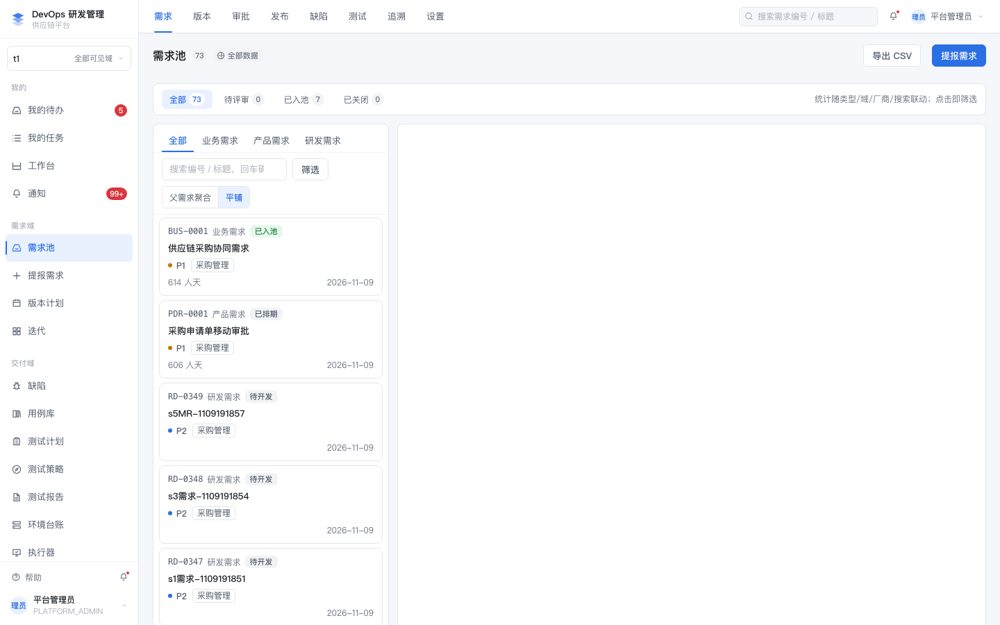<br>需求池：类型 Tab、父子聚合/平铺、CSV 导出 | 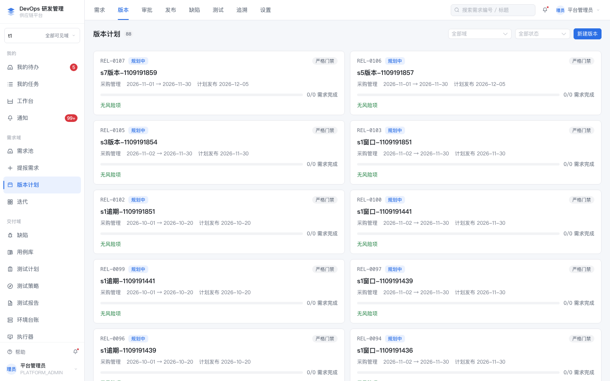<br>版本计划 + 里程碑 |
| 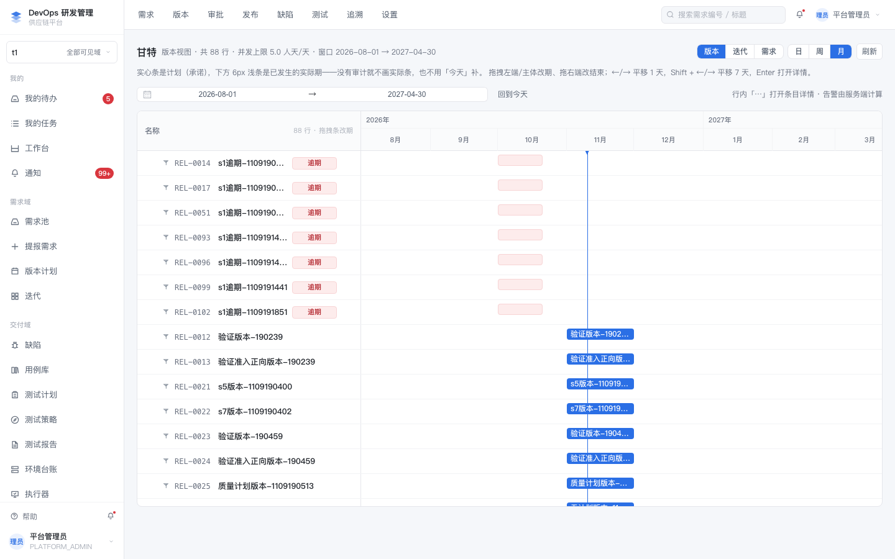<br>甘特：版本/迭代/需求三视图、拖拽改期、逾期标红 | 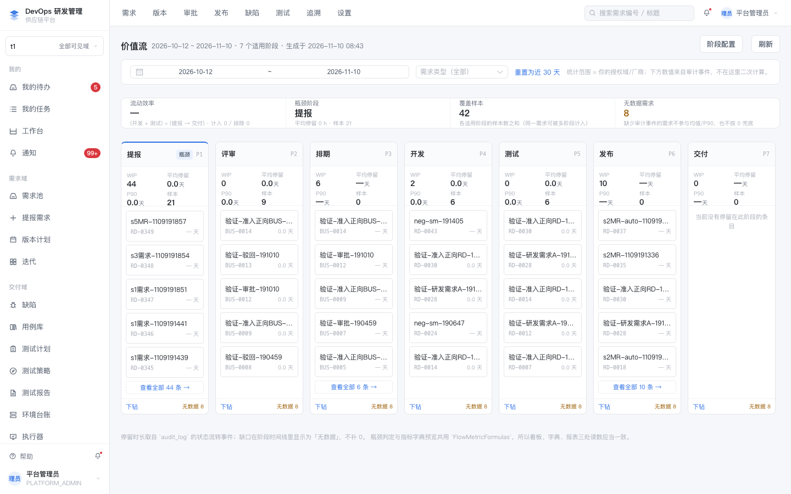<br>价值流：7 阶段 WIP、P90 停留、瓶颈阶段 |
| 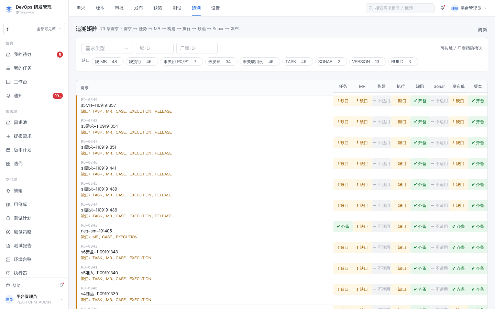<br>追溯矩阵：需求→任务→MR→测试→缺陷→发布 | 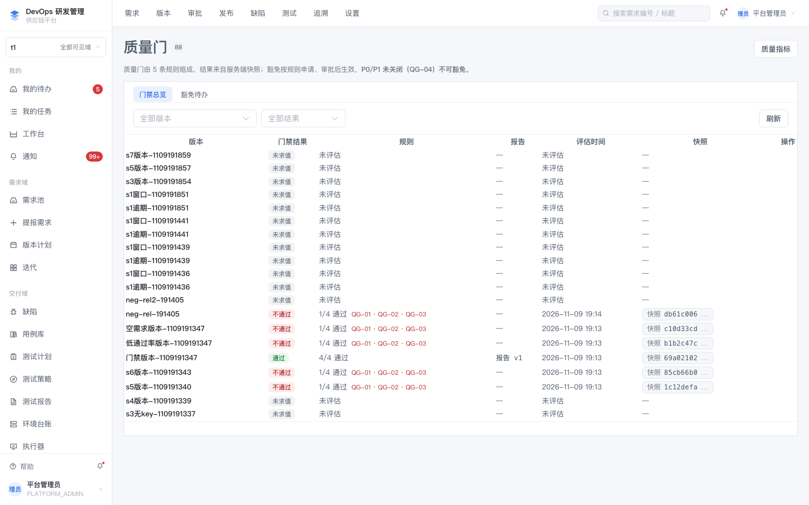<br>质量门总览 |
| 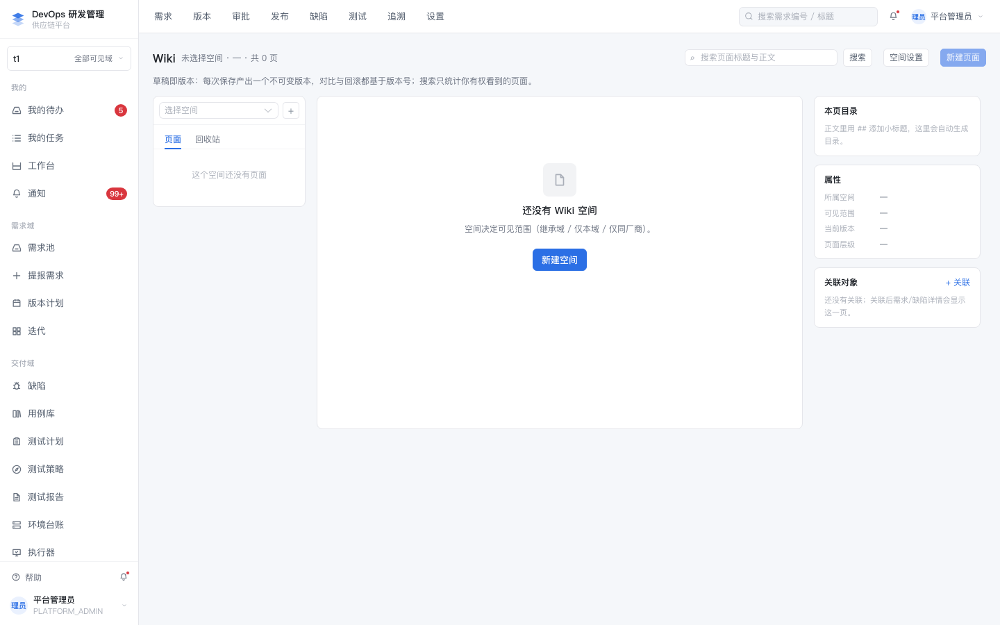<br>Wiki：空间/页面树/版本 | 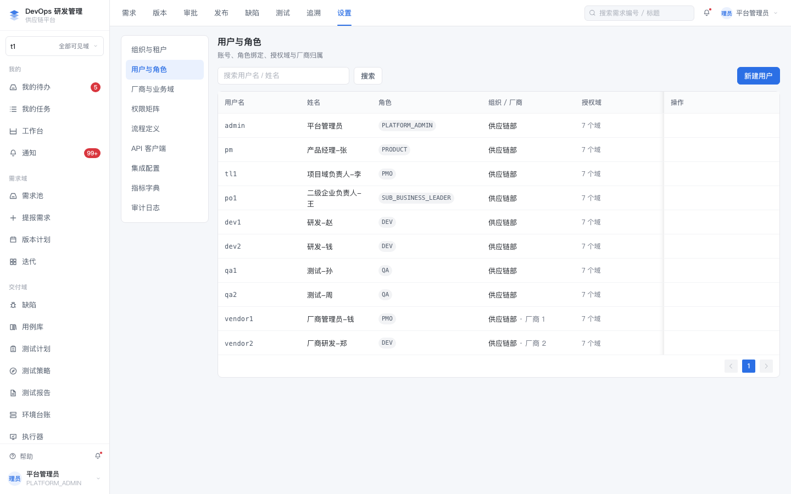<br>用户与角色（11 角色 × 61 功能码） |

### 7.2 业务角色视角

| | |
|---|---|
| 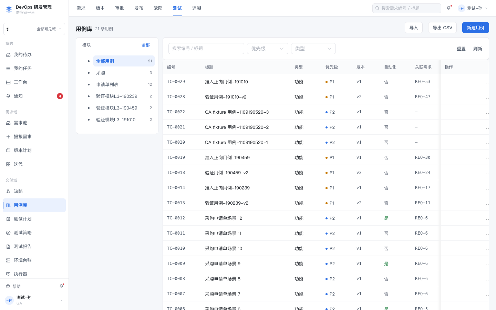<br>qa1：用例库（版本化、评审状态） | 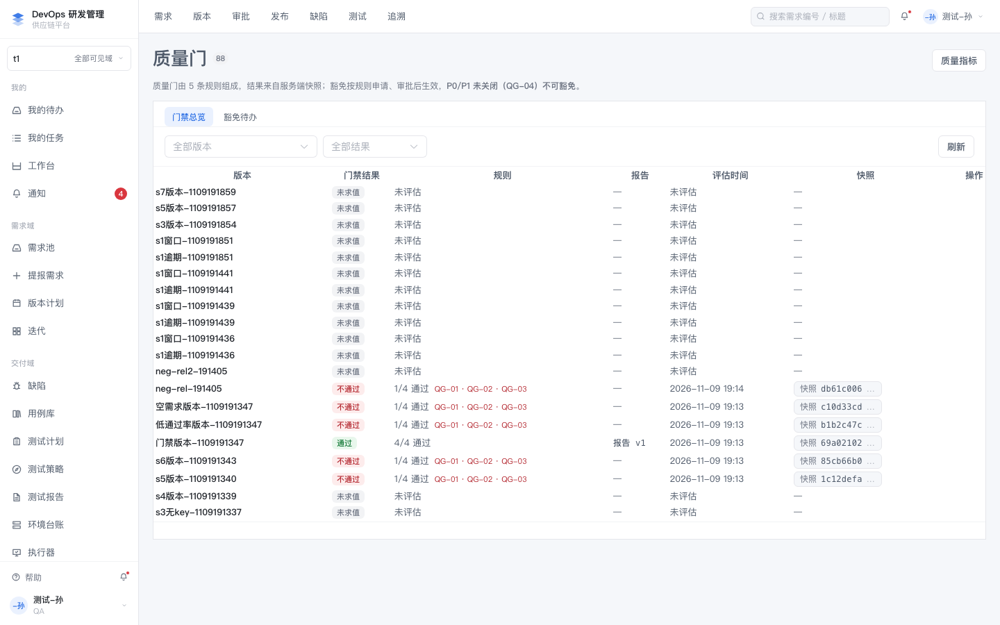<br>qa1：质量门（报告/规则/豁免） |
| 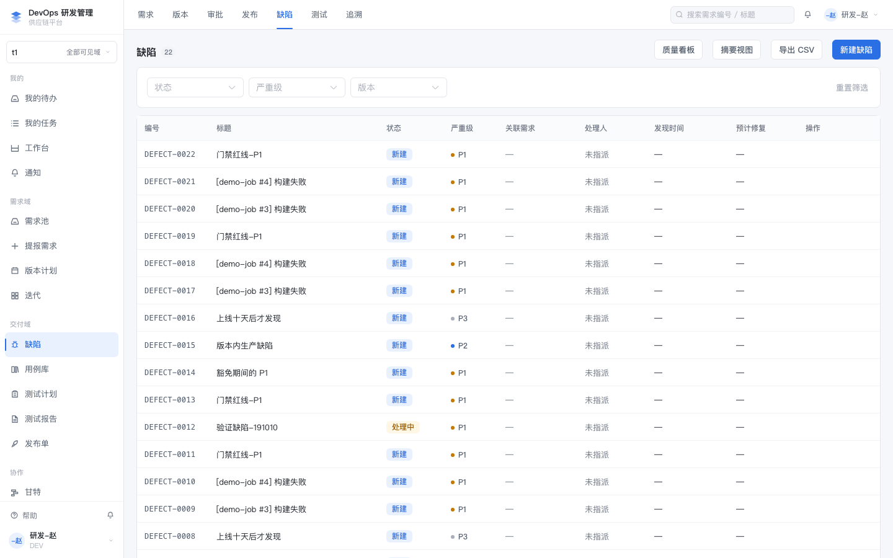<br>dev1：缺陷列表 | 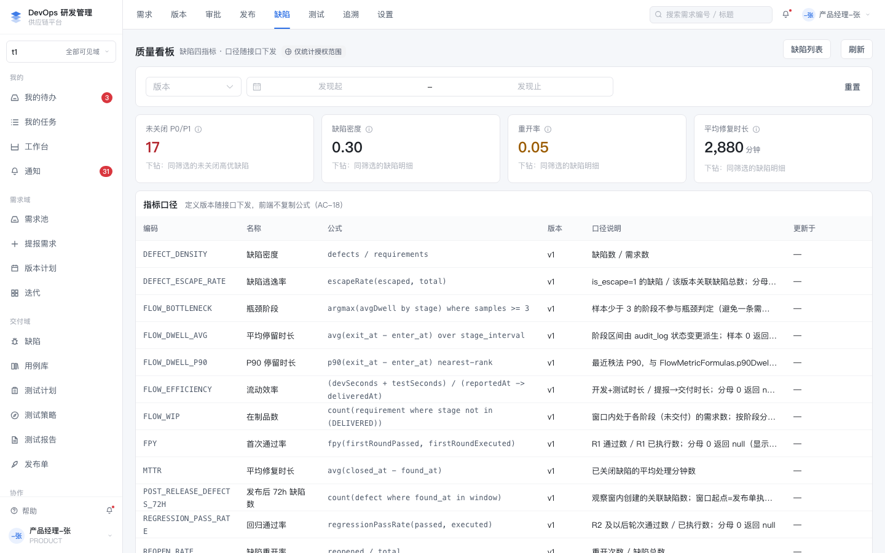<br>pm：缺陷看板 |
| 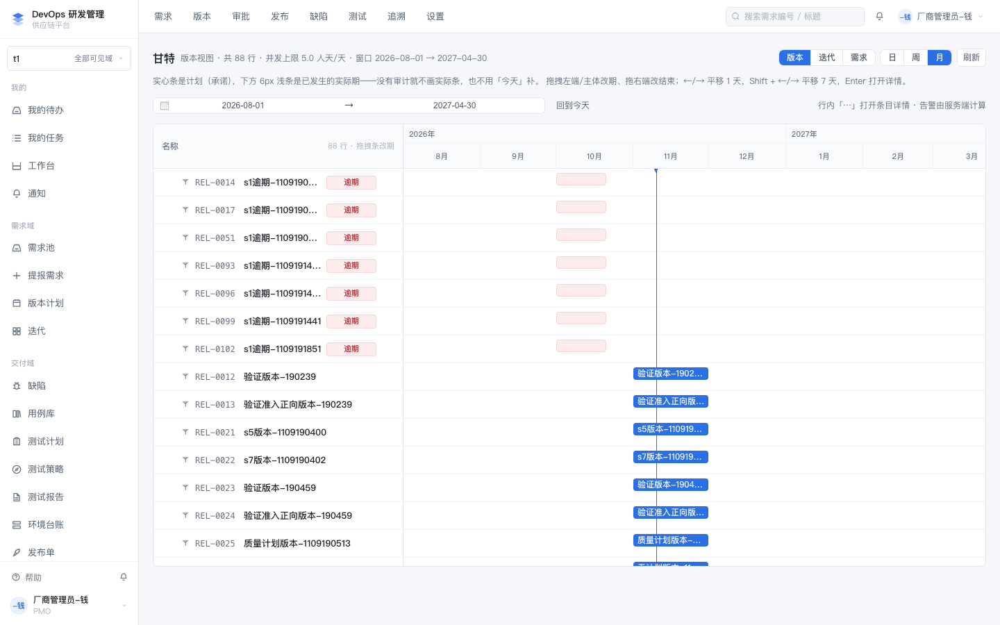<br>vendor1：甘特（只见本厂商承接） | 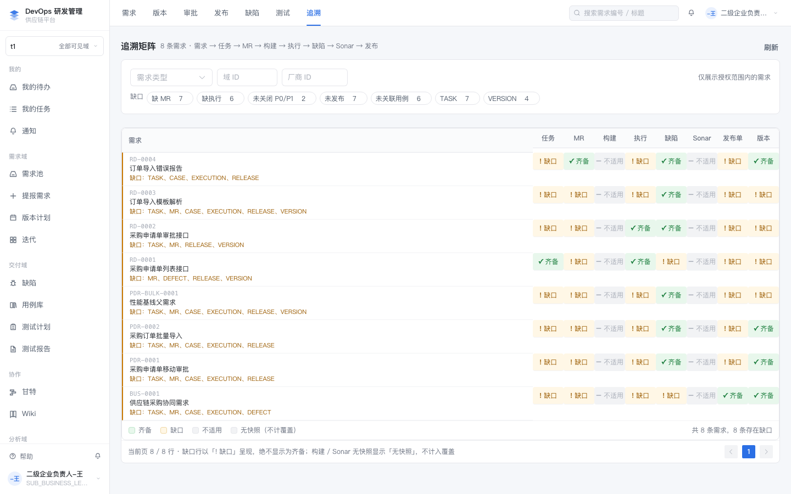<br>po1：追溯矩阵（二级企业视角） |

**r8 新增：dev1 打开分支策略（修复后）**

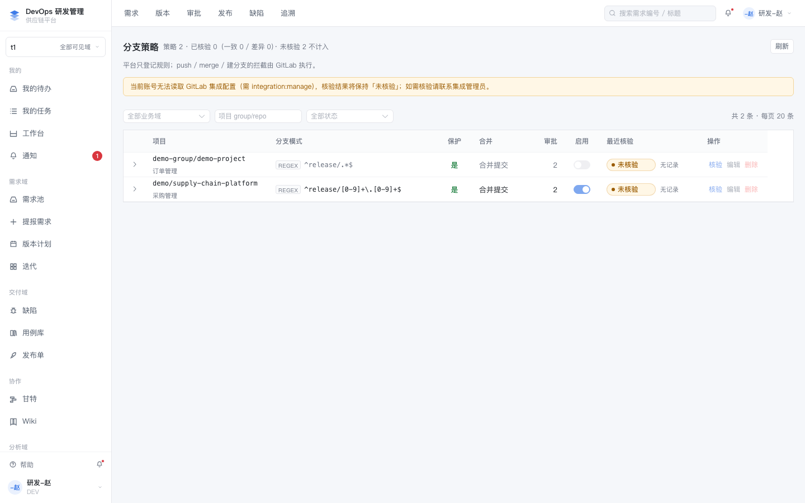

`dev1`（DEV，26 权限码）打开 `/code-policies` 的实测：URL 停在 `/code-policies`、筛选器与表格正常渲染 2 行、顶部常驻黄条写明「当前账号无法读取 GitLab 集成配置（需 integration:manage）」，行内 pill 为「未核验」。这张图是**页面级**证据：状态码 200 证明不了表格真的挂载、也证明不了黄条说的是权限原因。取证脚本 `logs/teamflow/tf-mwa402ox-br1nqs/scripts/shot-dev1-code-policies.mjs`（12 条断言：停留 / 无整页错误 / 表格 ≥1 行 / 黄条三关键词 / 禁词 / 1440×900）。

### 7.3 修复前证据（历史对照）

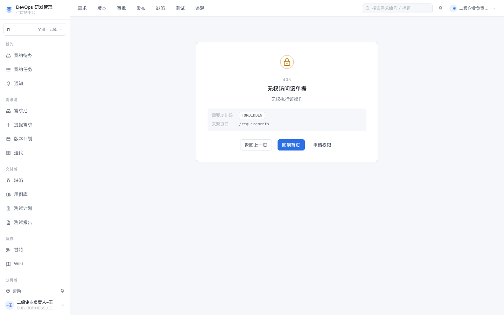

这张图是 r7 **修复前**的故障态，保留作对照：二级企业负责人 `po1` 打开 `/requirements` 直接落到全局 403 页（根因见 §6.1）。修复后 `po1` 打开需求池为 200 且看到 8 条，由 `make access-verify` 的 a2（状态码）与 a4（可见集）持续断言；页面级证据请按 §7.4 现截。

### 7.4 复现命令

```bash
make platform-up
make platform-demo-reset   # 干净演示数据（12 需求 / po1 见 8 / vendor1 见 3 / vendor2 见 0）
"/Applications/Google Chrome.app/Contents/MacOS/Google Chrome" --headless=new --no-sandbox \
  --remote-debugging-port=9222 --user-data-dir=/tmp/chrome-cdp about:blank &
# CDP：Target.createTarget → attachToTarget(flatten) → Page.navigate(/login)
#      → Runtime.evaluate 写 sessionStorage.setItem('devops.session', <登录响应>)
#      → Page.navigate(目标路由) → Page.captureScreenshot
```

## 8. 建议的下一步

1. **P1 收口**：岗位工作台、自助报表 —— 补齐实现或把 `DELIVERED-MODULES.md` 改成"设计已定、未排期"（本轮按 PRD 非目标处理，未动）。
2. **r7 遗留观察项**：`/testcases` 对 `dev1` 可见源自 `DEV` 对 `case:manage` 的 `RESTRICTED`（收窄而非拒绝）。若产品要求 `dev1` 不可见，需改权限矩阵，属独立需求。
3. M8-B 剩余：风险与基线、敏感信息扫描（其中的自动化规则引擎已由 r39 交付，见 §9）。

---

## 9. 自动化规则引擎（r39 · 三步脚本 + 3 张截图）

一条规则 = **触发事件 + 条件 + 动作**，可启停、有执行日志、能防循环。动作只有 4 类（通知 / 指派负责人 / 打标签 / 调 Webhook），**不改状态、不进审批、不动人天与发布单**——规则是"帮你做事"，不是"替你签字"。事件由服务端审计旁路产出（同一事务写 `automation_event`），前端没有任何上报入口：`/automation/events` 不存在，直接请求是 404。

### 9.1 前置

```bash
make platform-up
make platform-demo-reset   # 含 2 条演示规则，自检 80 项（原 76 + 自动化 4 项）
```

演示规则（`automation_rule`，作用域 = `ORD` 域）：

| 代号 | 规则名 | 触发 | 条件 | 动作 |
|---|---|---|---|---|
| R1 | P0/P1 新建通知域负责人 | `REQUIREMENT_CREATED` | `priorityIn = [P0,P1]` | `NOTIFY` → `DOMAIN_OWNER` |
| R2 | 大需求自动打标 | `FIELD_CHANGE` | `fields 含 estimate_days` 且 `estimateDays ≥ 10` | `ADD_TAG` → `大需求` |

导航「自动化规则」`http://127.0.0.1:5173/automation/rules`，页内双 tab：**规则** / **执行日志**（`/automation/runs`）。规则行是一句因果句 `[触发][作用域] 且 [条件] → [动作]`，列表、编辑器摘要、编辑回显三处同一组件渲染，不靠文案对齐。

### 9.2 三步脚本（admin）

| 步 | 操作 | 期望（约 5 秒内可复核） | 截图 |
|---|---|---|---|
| 1 | 确认 R1 为「已启用」→ 需求池新建 **P0** 需求（`ORD` 域） | 「执行日志」出现 1 行 `SUCCESS`，展开可见动作 `NOTIFY` 结果为成功；`tl1`（`ORD` 域负责人）通知 +1。建需求的 HTTP 请求**不等执行**——消费在后台 worker，业务侧响应时间不受规则影响 | `demo-shots/r39-automation-r1-success.png` |
| 2 | 把 `ORD` 域**叶子**需求 `DEMO-R-10`（RD，子需求）的 `estimateDays` 改成 **12**（≥10 命中 R2）。**不要改父需求**：父需求（P0/PDR）的人天由子需求汇总，改成父需求会 400 `PARENT_DAYS_READONLY`（r39 Q-2，原文档写的就是父需求，按字面走会撞墙） | 日志出现 `ADD_TAG` 行 `SUCCESS`；`DEMO-R-10` 在需求列表与详情概览都出现「**大需求**」chip（同一个 `TagChips` 组件，列表与详情同源——详情缺标签是 r39 Q-1，已修） | `demo-shots/r39-automation-r2-tag.png` |
| 3 | 规则列表把 R1 **停用** → 再新建一条 P0 需求 | 日志无新行（0 run）、`tl1` 无新通知；R1 行显示「已停用」，只降字色**不降透明度**（停用恰恰是最该核对配置的时刻） | `demo-shots/r39-automation-r1-disabled.png` |

三步的判据都是「**执行日志里有没有那一行**」，不是 toast：执行是异步的，页面弹一句"已触发"就是在撒谎。

### 9.3 负向三例（不截图，`make automation-verify` 已覆盖）

- **厂商账号**：`vendor1` 或 `vpm1` 深链 `/automation/rules` → 403 `INTERNAL_ONLY`（**不是** `FORBIDDEN`：`AutomationInternalOnlyInterceptor` 以 `order(-100)` 注册，早于权限校验；`vendor1` 的角色 `PMO` 本来是有 `automation:manage` 的，所以这一格证明了拦截来自"厂商"而不是"没权限"）。
- **作用域放宽**：规则作用域选 `ORD`，条件里再塞 `INV` 的域过滤 → 400 `CONDITION_WIDENS_SCOPE`。前端把条件的域/厂商行做成只读 `= 作用域`，先让人写不出来；服务端只是兜底。
- **动作越界**：动作只有 4 型可选，界面上没有"改状态""走审批"的入口；提交第 5 型被 400 拒绝，且 `scripts/tests/lint.sh` 的 L21 静态禁止 `automation` 包出现 `.transition(` / `ApprovalEngine` / `ReleaseService`。

### 9.4 自动门禁与复现

```bash
make automation-verify                          # 6 段 40 条：正例 / 负例 / 幂等 / 防循环 / 越权 / 停用+动作边界
bash scripts/automation-verify.sh --static-only # 免栈的静态部分
```

幂等与防循环各有一条可复述的判据：同一业务动作重放不会产生第 2 次执行（`automation_run` 的 `(tenant, rule, requirement, event)` 唯一键先抢后判）；规则触发的动作**不再**作为新事件进入求值（`origin=RULE` 直接丢弃），人工 `deliver` 后再触发也会在链深 ≥4 时丢弃。

截图按 §7.4 的 CDP 流程现截（路由换 `/automation/rules` 与 `/automation/runs`），1440×900，落 `docs/teamflow/demo-shots/`。该目录必须可提交：`git check-ignore -v docs/teamflow/demo-shots/r39-automation-r1-success.png` 无输出（未被忽略）。

## 4.12 需求池运营：相似提示 / 我也需要 / 合并重复（r47 新增）

**角色与入口**：`pm`/`biz1`/`biz2`/二级企业 → 「需求池」`/requirements`、提报 `/requirements/new`、详情 `/requirements/{id}`。

**数据**：演示基线 13 条需求（新增 `DEMO-R-13` 采购订单移动审批（二期），与 `DEMO-R-02` 相似度 4.5）；`DEMO-R-02` 预置 6 条跟单（biz1/biz2/po1/suite1/vendor1 等），账号 `biz2`（陈业务2，业务部门）为 r47 新增的第 15 个种子账号。

**三步脚本（约 3 分钟）**

1. 「提报需求」→ 标题填「采购订单移动审批」→ 400ms 后出现「发现 6 条相似需求」列表（编号/标题/状态/「N 人需要」），点任一条可直达详情；相似提示不阻断提报。
2. 打开 `DEMO-R-02` → 右侧「需求热度」卡显示「6 人需要」，点「我也需要」立即 +1（重复点不叠加，靠唯一键幂等）；「查看全部 6 人」开抽屉按组织聚合。
3. 同页「合并重复需求」→ 弹层选目标（编号精确匹配或从相似列表选）+ 填原因 → 确认后源需求关闭、跟单与子需求迁到目标、审计记 `REQUIREMENT_MERGED`；列表卡片显示「已并入 #N」徽标。

**可现场验证的边界**

- 终态（CLOSED/ACCEPTED_CLOSED/DONE/已合并）不能「我也需要」→ 按钮禁用并给原因；接口 409 `REQUIREMENT_CLOSED`。
- 合并前置 6 条：源/目标不能同一、源不能已合并、目标不能是源的后代（环）、源目标同租户同域、源不能是终态；违反给 400/409 具体错误码。
- 相似检索只回 `ACTIVE` 且未合并的需求，`CLOSED` 与已合并的都不出现；同域 +1 分（参照域取请求的 `domainId`）。

```bash
make platform-up && make platform-seed && make platform-demo-reset
make pool-ops-verify   # 33 条：P1 相似 7 / P2 跟单 9 / P3 合并 9 / P4 回归 8
```

**截图**：`docs/teamflow/demo-shots/pool-1-similar-hint.png`、`pool-2-follow-card.png`、`pool-3-merge-dialog.png`。

## 4.11 产品需求评审 + 厂商工时评估（r46 新增，评审中心）

**角色与入口**：产品经理/项目域负责人/评审人 → 左侧「需求域 · 评审中心」（`/pdr-reviews`，页面码 `pdr.review`）。

**数据**：演示基线自带 1 张评审单（`DEMO-R-02` 采购订单移动审批）4 名评审人 6 条意见（其中 1 条已转任务）、2 个附件。

**四步脚本（约 3 分钟）**

1. 打开「评审中心」→ 上部看四个 KPI（评审单 1 / 意见 6 / 需修改率 16.7% / 平均评审时长）与「意见分类分布」（九类，RANGE 2、TECH 2、ACCEPTANCE 1、DATA 1），右栏「按评审人 Top5」。
2. 点任意一条评审单 → 评审单详情：顶部 `3/4 已评`、评审人 chip（通过/需修改/待评）、按人分组的意见（每条带分类徽标、序号、状态徽标「待处理 / 已转任务」、附件 chip）。
3. 在「待处理」意见上点「转为任务」→ 选择负责人/截止日期 → 创建后该条变「已转任务 #任务号」，任务表多一行、审计记 `PDR_OPINION_TO_TASK`（重复点会 409）。
4. 回到需求详情 `DEMO-R-02` → 「评审」Tab 能看到同一份评审单与评审状态（概要页右侧也显示「评审状态：评审中 · 3/4 已评」）。

**顺序门（可现场验证，也是这轮的重点）**

- 新建的 PDR 未过评审时：`转派`/`提交评估`/`排期` 全灰，接口 409 `PDR_REVIEW_REQUIRED`（detail 带 `required:"pdr_review"`）。
- 过了评审但没指派厂商 → `提交评估` 409 `VENDOR_NOT_ASSIGNED`。
- 指派厂商后由**厂商账号**（vpm1）提交评估 → 201；产品经理提交 → 403（只审不提）。
- 评估通过后换厂商 → 原评估单转 `STALE`（需重评）；子 RD 已进 `IN_DEV` 再换厂商 → 409 `VENDOR_LOCKED`（detail 带阻塞子需求 id）。

```bash
make pdr-verify                                 # 6 段 66 条：顺序门/评审/换厂商/附件/统计/多条意见转任务
bash scripts/pdr-flow-verify.sh --dry-run       # 免栈只打印断言清单
```

截图：`docs/teamflow/demo-shots/pdr-1-review-center.png`、`pdr-2-review-detail.png`、`pdr-3-requirement-tab.png`。
