# 平台功能总览与角色演示手册

> 生成时间：2026-11-10（r7 角色准入修复轮） · 代码基线 `main = ea877fa` + 本轮改动 · 环境 `make platform-up`（req 8082 / deliver 8083 / gateway 8080 / web 5173 / MySQL `devops_platform`）
> 本文的权限码与准入格取自 `PermissionMatrix.java` 与本轮路由 `meta.functionCode`，可用 `make access-verify` 在本机复核（见 §6.3）。**先说结论：功能面是齐的，r7 修掉的两条 P0（字典 403、菜单与路由不同源）已交付并有自动化证据**，见 §6。

---

## 1. 演示环境与账号

```bash
make platform-up            # 拉起 MySQL + req + deliver + web，末尾打印 READY
open http://127.0.0.1:5173  # 登录页，租户 t1
make platform-down          # 演示结束
```

| 账号 | 姓名 | 角色 | 密码 | 权限码 | 可见需求数 |
|---|---|---|---|---|---|
| `admin` | 平台管理员 | PLATFORM_ADMIN | `Admin@12345` | 56 | 12 |
| `pm` | 产品经理-张 | PRODUCT | `Passw0rd!` | 26 | 12 |
| `tl1` | 项目域负责人-李 | PMO（域负责人） | `Passw0rd!` | 40 | 12 |
| `po1` | 二级企业负责人-王 | SUB_BUSINESS_LEADER | `Passw0rd!` | 11 | **8**（仅本企业提报） |
| `dev1` | 研发-赵 | DEV | `Passw0rd!` | 24 | 12 |
| `dev2` | 研发-钱 | DEV | `Passw0rd!` | 24 | 12 |
| `qa1` | 测试-孙 | QA | `Passw0rd!` | 33 | 12 |
| `qa2` | 测试-周 | QA | `Passw0rd!` | 33 | 12 |
| `vendor1` | 厂商管理员-钱 | PMO + 厂商 VEN-A | `Passw0rd!` | 40 | **3**（仅本厂商承接） |
| `vendor2` | 厂商研发-郑 | DEV + 厂商 VEN-B | `Passw0rd!` | 24 | **0**（未承接） |
| `biz1` ᵃ | 陈业务 | BUSINESS（业务部门） | `Passw0rd!` | 8 ᵃ | 8 ᵃ |
| `suite1` ᵃ | 许二级 | SUB_BUSINESS_LEADER（二级企业业务） | `Passw0rd!` | 11 ᵃ | 8 ᵃ |

ᵃ 本轮新增的两个种子账号。权限码由 `PermissionMatrix` 推导（`node logs/teamflow/tf-mw9yzocw-5kv3pt/scripts/t10-role-grants.mjs`，该推导口径已用 admin/pm/tl1/po1/dev1/qa1 六个账号的既有实测值对账通过）；「可见需求数」中 12/8/3/0 由 `make platform-demo-reset` 的 4 条不变量断言，`biz1`/`suite1` 的两个 8 是按 po1 同组织同域口径推导、未被不变量单独断言。

**隔离是真实生效的**：同一租户下全量角色看到 12 条（`make platform-demo-reset` 后的干净数据集），`po1`（二级企业负责人）只看到本企业 8 条，`vendor1` 只看到本厂商承接的 3 条，`vendor2` 0 条。

> 已补齐：`BUSINESS`（业务部门）与二级企业业务账号不再缺位。`biz1` 用于演示"业务方自己提报"，`suite1` 与 `po1` 同角色（`SUB_BUSINESS_LEADER`）用于演示"二级企业业务读面"，两者与 `po1` 同租户 t1、同组织 supplyOrg，并在种子循环里绑同一组 7 个业务域，故数据范围天然同源。

---

## 2. 已交付能力地图（按域，均为页面实测可打开）

| 域 | 能力 | 入口页 |
|---|---|---|
| 需求 | 三类需求（BUS/PDR/RD）、三层父子拆解、需求池（入池/待评审/关闭统计）、编号规则、CSV 导出 | `/requirements` `/requirements/:id` `/requirements/new` |
| 审批 | 自研审批引擎：提报/评审入池/版本/发布四类单据、会签/或签、条件分支、加签/减签、转办/撤回/催办、流程定义（版本化） | `/approvals` `/admin/workflows` |
| 版本与发布 | 版本计划（Release）+ 里程碑、发布单、准入校验 9 项（需求全测过/无未关闭 P0·P1/MR/人天/审批/构建/Sonar/制品/门禁）、PMO 强制放行留痕 | `/releases` `/deploy-orders` |
| 研发交付 | 任务、迭代看板、MR 区（GitLab 同步）、追溯矩阵（需求→任务→MR→测试→缺陷→发布） | `/iterations` `/traceability` |
| 缺陷 | P0–P3、状态机、重开计数、看板、失败转缺陷、生产缺陷回流 | `/defects` `/defects/board` |
| 测试 | 用例库（版本化）、用例评审单、测试计划（策略/轮次/执行/分配）、测试报告三签、质量门、豁免、环境台账、执行器健康 | `/testcases` `/test-plans` `/test-reports` `/quality-gates` `/test-envs` `/test-executors` |
| 协作（M8） | 甘特（版本/迭代/需求三视图、拖拽改期落库+审计）、Wiki（空间隔离/版本回滚/全文检索/回收站）、价值流（7 阶段、WIP、P90 停留、流动效率、瓶颈） | `/gantt` `/wiki` `/value-stream` |
| 代码与集成（M7/M8） | 分支策略登记与 GitLab 现状核验（MATCH/DRIFT/UNVERIFIED）、CR 行级评论、Sonar 质量摘要、四系统集成配置 | `/code-policies` `/admin/integrations` |
| 平台治理 | 组织/租户/用户/角色/权限矩阵（10 角色 × 56 功能码）、指标字典、审计日志、API 客户端 | `/admin/*` |

规模：REST 接口 196 个映射、前端 54 个页面、业务表 53 张、验证套件（r1 14 / platform 168 / quality 348 / integration 230 / collab 263 / access 约 85 / negative 25 / unit 234 / lint 16）。

---

## 3. 角色 × 页面可用性矩阵（r7 修复后 · 9 账号 × 13 页）

| 页面 | admin | pm | tl1 | po1 | dev1 | qa1 | vendor1 | biz1 | suite1 |
|---|---|---|---|---|---|---|---|---|---|
| 需求池 `/requirements` | ✅ | ✅ | ✅ | ✅ | ✅ | ✅ | ✅ | ✅ | ✅ |
| 版本计划 `/releases` | ✅ | ✅ | ✅ | ✅ | ✅ | ✅ | ✅ | ⛔⁴ | ✅ |
| 审批中心 `/approvals` | ✅ | ✅ | ✅ | ✅ | ✅ | ✅ | ✅ | ✅ | ✅ |
| 测试计划 `/test-plans` | ✅ | ✅ | ✅ | ⛔⁴ | ⛔⁴ | ✅ | ✅ | ⛔⁴ | ⛔⁴ |
| 用例库 `/testcases` | ✅ | ✅ | ✅ | ⛔¹ | ✅³ | ✅ | ⛔³ | ⛔¹ | ⛔¹ |
| 缺陷 `/defects` | ✅ | ✅ | ✅ | ✅ | ✅ | ✅ | ✅ | ✅ | ✅ |
| 甘特 `/gantt` | ✅ | ✅ | ✅ | ✅ | ✅ | ⛔² | ✅ | ✅ | ✅ |
| Wiki `/wiki` | ✅ | ✅ | ✅ | ✅ | ✅ | ✅ | ✅ | ✅ | ✅ |
| 价值流 `/value-stream` | ✅ | ✅ | ✅ | ⛔² | ⛔² | ⛔² | ✅ | ⛔² | ⛔² |
| 追溯矩阵 `/traceability` | ✅ | ✅ | ✅ | ✅ | ✅ | ✅ | ✅ | ✅ | ✅ |
| 质量门 `/quality-gates` | ✅ | ✅ | ✅ | ⛔² | ✅ | ✅ | ✅ | ⛔² | ⛔² |
| 分支策略 `/code-policies` | ✅ | ⛔² | ✅ | ⛔² | ✅ | ⛔² | ✅ | ⛔² | ⛔² |
| 用户与角色 `/admin/users` | ✅ | ⛔² | ⛔² | ⛔² | ⛔² | ⛔² | ⛔² | ⛔² | ⛔² |

¹ `po1`/`biz1`/`suite1` 无 `case:manage`，用例库入口不渲染，深链落 `/403`。
² 角色确实没有该功能码（`DENY`），入口隐藏且深链 403 —— 这是权限矩阵的正确拒绝，不是故障。
³ `dev1` 可见用例库、`vendor1` 不可见：前者是 DEV 对 `case:manage` 持 `RESTRICTED`（收窄数据范围而非拒绝，详见 `docs/teamflow/20261110-r7-role-page-access-fix/TECHNICAL.md` §7 记为唯一偏差）；后者是 `/testcases` 带 `meta.internalOnly`，厂商账号深链一律落 `/403?code=INTERNAL_ONLY`。
⁴ 5 格 ⛔ 与 §6.2 同一张表：`/test-plans` 要 `plan:manage`（`po1`/`dev1`/`biz1`/`suite1` 无），`/code-policies` 要 `CCODE_POLICY_VIEW`（`pm`/`po1`/`qa1` 无），`/releases` 要 `release:plan`（`BUSINESS` 未授）。矩阵未新增任何权限码。

> 判据是**两段同源**：菜单看 `navVisible()`，路由看 `meta.functionCode`，`nav` 的码是 `meta` 的码的子集，故"看得见"与"点得开"不会再分叉（§6 P0-2）。

---

## 4. 各角色演示脚本

### 4.1 平台管理员 `admin`（可走通全流程的角色）
1. 需求池 `http://127.0.0.1:5173/requirements`：看 12 条、类型 Tab、筛选与 CSV 导出。
2. 点任意需求进详情：父子需求、子需求进度、审批流转时间线、人天预估/已投入/偏差、关联版本。
3. 版本计划 `/releases` → 打开版本详情（工作项、准入 9 项清单、状态计数胶囊）。
4. 测试计划 `/test-plans` → 计划详情六 tab（生命周期/用例/轮次/执行/报告/风险）；执行页勾结果。
5. 质量门 `/quality-gates` → 单版本质量门详情（报告结论、5 条规则、豁免、快照回放）。
6. 甘特 `/gantt` → 切版本/迭代/需求三视图与日/周/月；拖拽右端改期（落库 + 审计 + 超父窗口 409 确认）。
7. 价值流 `/value-stream`：7 阶段 WIP、P90 停留、瓶颈阶段、流动效率（数据全部取自 `audit_log`）。
8. Wiki `/wiki`：建空间（可见范围 继承/仅本域/仅本厂商）、写页、看版本对比与回滚、回收站。
9. 分支策略 `/code-policies`：登记规则 → "对照核验" GitLab 现状（未配置集成时 必须显示 UNVERIFIED，不得假绿）。
10. 设置 `/admin/users`、`/admin/permissions`（10×56 权限矩阵）、`/admin/audit`（审计日志）。

### 4.2 产品经理 `pm`（权限 26）
- 可演示：`/requirements`、`/releases`、`/approvals`、`/testcases`、`/defects`、`/gantt`、`/wiki`、`/value-stream`、`/traceability`、`/quality-gates`、`/admin/workflows`。
- 不可演示（矩阵拒绝，非故障）：`/test-plans`、`/code-policies`、`/admin/users`。
- 工作台 `/workbench` 目前是**质量工作台**（待批准计划/待会签报告/待审批豁免/我的待执行用例），实测 pm 待会签 6 份 —— 这是 M6 的岗位化视图，不是 PRD §4.10 那张"待办四宫格"。
- 主线剧本：需求池 → 评审入池审批 → 拆解产品/研发需求 → 排版本 → 会签测试报告。

### 4.3 项目域负责人 `tl1`（权限 40，PMO 视角）
- 可演示：域内需求池、版本计划、审批中心、测试计划、用例库、缺陷、甘特、Wiki、价值流、追溯矩阵、质量门、分支策略、流程定义、指标字典、审计。
- 典型动作：域内需求按域过滤、发布单强制放行、版本准入裁决。

### 4.4 二级企业负责人 `po1`（权限 11，隔离演示的最佳角色）
- 实测：`/requirements` 只返回本企业 8 条（隔离生效），页面已可直接打开；也可用 API 复核：
  ```bash
  TOKEN=$(curl -s -X POST http://127.0.0.1:8080/api/req/auth/login -H 'Content-Type: application/json' \
    -d '{"tenantCode":"t1","username":"po1","password":"Passw0rd!"}' | jq -r .token)
  curl -s -H "Authorization: Bearer $TOKEN" -H 'X-Tenant-Id: 1' \
    'http://127.0.0.1:8080/api/req/requirements?page=1&size=5' | jq '.total'   # → 8
  ```
- 可演示页面：需求池、版本计划、审批中心、缺陷、甘特、Wiki、追溯矩阵。
- 不可演示（矩阵拒绝）：测试计划、用例库、价值流、质量门、分支策略、管理后台。

### 4.5 研发 `dev1` / `dev2`（权限 24）
- 可演示：需求池、版本计划、审批中心、缺陷（处理/转测试）、用例库、甘特（可编辑改期）、Wiki（可编辑）、追溯矩阵、质量门、分支策略。
- 不可演示（矩阵拒绝）：测试计划、价值流、管理后台。
- `vendor2` 用于演示厂商 0 承接：用它的 token 调 `/requirements` 返回 `total=0`。

### 4.6 测试 `qa1` / `qa2`（权限 33，权限最完整的业务角色）
1. 用例库 `/testcases`：建用例、发起用例评审（绑 `case_version`，改版自动 INVALIDATED）。
2. 测试计划 `/test-plans`：计划七态、轮次 R1/R2/R3、执行结果四态、通过率/覆盖率。
3. 测试报告 `/test-reports`：生成 → 三签（测试负责人→产品→PMO）→ 带水印导出。
4. 质量门 `/quality-gates`：报告 PASS 且 7 天内、通过率 ≥95%、未关闭 P0/P1=0、第 5 规则（Sonar/制品/构建）。
5. 环境台账 `/test-envs`、执行器 `/test-executors`（外部 CI 上报的健康状态，24h 在线 / 72h 陈旧）。
6. 追溯矩阵 `/traceability`：按缺口筛选（需求没用例、用例没执行、缺陷没关联）。
- 不可演示（矩阵拒绝）：甘特、分支策略、管理后台。

### 4.7 厂商管理员 `vendor1`（PMO + VEN-A，演示域×厂商双维度隔离）
- 实测：`/requirements` 总量 3（只本厂商承接）、缺陷 3；甘特、Wiki、价值流、质量门、追溯可用。
- 用例库对厂商账号不可见（`internalOnly`），管理后台按矩阵不可见：这是本次修复让"厂商账号只能待在厂商面"的入口级证据。
- 演示话术：同一个 URL、同一个租户，换账号后数据从 12 条变成 3 条——这就是"行级双维度隔离 + 六出口同源过滤"。

### 4.8 业务方 `biz1` / `suite1`（权限 8 / 11，本轮新增账号）
- `biz1`（BUSINESS）：可提报业务需求（`req:report:bus`）、看本组织需求池（8 条）、审批待办、缺陷、甘特、Wiki、追溯矩阵、质量指标。
- 不可演示（矩阵拒绝）：版本计划、测试计划、用例库、价值流、质量门、分支策略、管理后台 —— 与 §3 的 `biz1` 列一致。
- `suite1`（SUB_BUSINESS_LEADER）：在 `biz1` 基础上多 `release:plan`（受限）与 `req:review`，故版本计划可打开、可参与评审。
- 首次登录即验证：两个账号都不出现测试计划/分支策略/管理后台菜单（`make access-verify` 的 a4 段断言关键隐藏项）。

---

## 5. 端到端演示剧本（15 分钟）

| 步 | 账号 | 动作 | 预期 |
|---|---|---|---|
| 1 | `biz1` | 提报业务需求 | 进入"待评审"，触发"产品评审"会签待办 |
| 2 | `pm` | 产品评审会签通过 → 入池 | 状态 待评审→已入池，集团需求池可见（仅标题/摘要/域/版本） |
| 3 | `pm` | 拆解产品需求 + 研发需求 | 父子链路建立，父需求完成率开始汇总 |
| 4 | `pm` | 排入 2026 Q4 版本 | 版本详情出现工作项，甘特出现计划条 |
| 5 | `dev1` | 交付：填 MR、预估/实际人天 | 需求→待测试，追溯矩阵出现 MR 节点 |
| 6 | `qa1` | 执行测试计划 → 失败转缺陷 | 缺陷带用例/版本/需求；计划通过率下降 |
| 7 | `qa1` | 缺陷修复后复测 → 生成测试报告 → 三签 | 报告 PASS，质量门变绿（含 9 项准入） |
| 8 | `tl1`/`pm` | 提交发布单 → 准入校验 | 9 项逐项展示；FAIL 禁提交，PMO 放行留痕 |
| 9 | `admin` | 甘特看交付节奏 / 价值流看瓶颈 | 停留时间与审计事件一致，三处读数差 0 |

> 步 2 的审批人是 `PRODUCT` 角色（种子流程"产品评审"单节点 ALL 会签），即 `pm`，不是 `po1` —— 旧版剧本把审批人写成 `po1` 是笔误，本轮改正。

---

## 6. 本轮修复的两条 P0（已修复，含验证命令）

### 6.1 P0-1 共享字典接口 403 → 全局跳 403（已修复）
- 修复前现象：`pm` 打开 `/requirements`、`/releases`、`/approvals`、`/test-plans`、`/code-policies` 都落到"无权访问该单据（需要功能码 FORBIDDEN）"；根因是页面加载时调 `/api/req/admin/{domains,vendors,users}` 取显示名，这三个接口要 `org:manage`，非管理员 403，而 `web/src/api/client.ts` 对任何未声明 `silentForbidden` 的 403 做全局 `navigate('/403')`。
- 修复：后端新增**只读字典端点** `GET /api/req/dictionaries/{domains,vendors,users}`（仅认证、按 `DataScope` 裁剪租户/厂商边界、`record` 形状固定字段白名单，故意不进 `PermissionRouteTable` 并用单测钉住）；前端字典读取统一收敛到单入口 `web/src/api/dictionaries.ts`（各业务页不再直连 `api/admin.ts`），全部声明 `silentForbidden` 并在内部降级。管理面 `/admin/*` 的 `org:manage` 语义不变。
- 验证：`a0`（字典契约 29 断言：401/200/字段白名单/404/管理面仍 403）+ `a1`（裁剪与隔离 8 断言）。

### 6.2 P0-2 菜单与路由不同源 → 看得见点不开（已修复）
- 修复前现象：`po1` 能看到"用例库"却点开 403；`dev1` 有 `CCODE_POLICY_VIEW` 却在分支策略被 403；`pm` 顶栏看到"设置"点开 403（特判含 `workflow:manage` 却落 `/admin/orgs`，需 `org:manage`）。
- 修复：新增 `web/src/layouts/navAccess.ts` 的 `navVisible()` 作为侧栏与顶栏**唯一**准入判定；`NavItem.functionCode` 改为必填（33 条侧栏 + 8 条顶栏逐项赋值，登录可读用 `AUTHENTICATED` 哨兵）；5 条路由 `meta` 补齐并保证 nav 码 ⊆ meta 码；`/testcases` 加 `meta.internalOnly`（厂商账号入口级 403，不改权限矩阵）；删除 `TopNav.vue` 的 admin 内联六码特判。
- 5 格 ⛔（7 角色 × 5 页探测矩阵内）与本轮定性：

  | 页面 | ⛔ 角色 | 触发码 | 定性 |
  |---|---|---|---|
  | `/test-plans` | `po1` `dev1` | `plan:manage` | 矩阵拒绝，符合 AC-5 |
  | `/code-policies` | `pm` `po1` `qa1` | `CCODE_POLICY_VIEW` | 矩阵拒绝，符合 AC-5 |
  | 其余 30 格 | — | — | 200，入口与接口同源放行 |

- 验证：`a2`（5 页 × 7 角色 35 条精确状态码）+ `a3`（导航静态审计：码必填/值域/nav⊆meta/前缀/silentForbidden/客户端 403 守卫）+ `a4`（7 角色真实权限推导可见集）。

### 6.3 验证命令

```bash
make access-verify            # a0..a4 五段聚合，PASS==TOTAL 才退出 0；栈未起非 0 退出
bash scripts/tests/access/a0-dictionary-contract.sh   # 只跑字典契约
bash scripts/tests/access/a1-isolation.sh             # 只跑租户/厂商裁剪
bash scripts/tests/access/a2-page-matrix.sh           # 只跑 5 页 × 7 角色状态码
node scripts/tests/access/a3-nav-audit.mjs            # 只跑导航静态审计（不需起栈）
node scripts/tests/access/a4-nav-visibility.mjs       # 只跑角色可见集推导（不需起栈）
```

### P1：文档与实现不一致（本轮未修，非目标）
- `DELIVERED-MODULES.md:96-98` 把**岗位工作台**（待办中心 + 快捷动作 + 数据卡片 + 我的列表）和**自助报表**（拖拽交叉表 → 图表 → 保存/共享/导出）列为已交付；实际代码里 `/workbench` 是 M6 的**质量工作台**（`WorkbenchQuery` 只有计划卡/用例卡/汇总），也没有任何 `/reports` 路由与报表接口（`report_definition` 表/接口 0 命中）。
- 建议：要么另开需求补，要么把文档改成"设计已定、未排期"。

### P2：演示数据被验收夹具污染（已提供一键重置）
- 修复前：需求池 73 条中大部分是 `s1/s5/s7/neg-sm-*` 夹具，人天出现 614 天；甘特首屏 88 行也是夹具（大量"逾期"）；通知 99+。
- 干净演示做法（单事务重建，连跑两次结果一致，失败整体回滚）：
  ```bash
  make platform-demo-reset
  ```
  该命令调内部端点 `POST /api/req/internal/demo-reset`（需 `X-Internal-Token`，且 `PLATFORM_SEED_ENABLED` 关闭时端点不存在），重建 12 条需求小链路 + 1 版本 + 1 迭代 + 12 用例 + 3 缺陷 + 1 测试计划 + 1 甘特组 8 行 + ≤5 通知，并自检 4 条不变量（需求 12 / `po1` 见 8 / `vendor1` 见 3 / `vendor2` 见 0）与夹具痕迹清零；不进自动门禁，属演示前手动动作。
- 账号缺口已补：`biz1`/`suite1`（§1）。

---

## 7. 截图与复现

截图都在 `docs/teamflow/demo-shots/`（1440×900，headless Chrome + CDP 注入会话）。

### 7.1 平台管理员视角（核心流程）

| | |
|---|---|
| 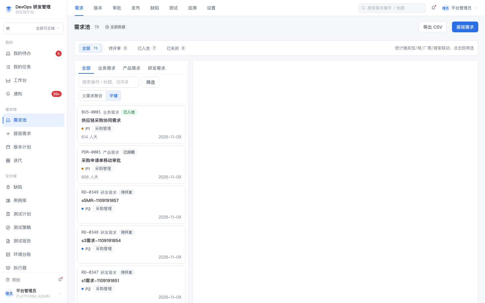<br>需求池：类型 Tab、父子聚合/平铺、CSV 导出 | 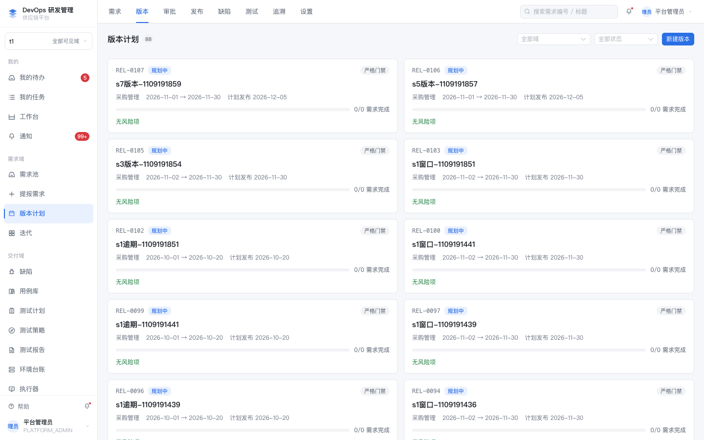<br>版本计划 + 里程碑 |
| 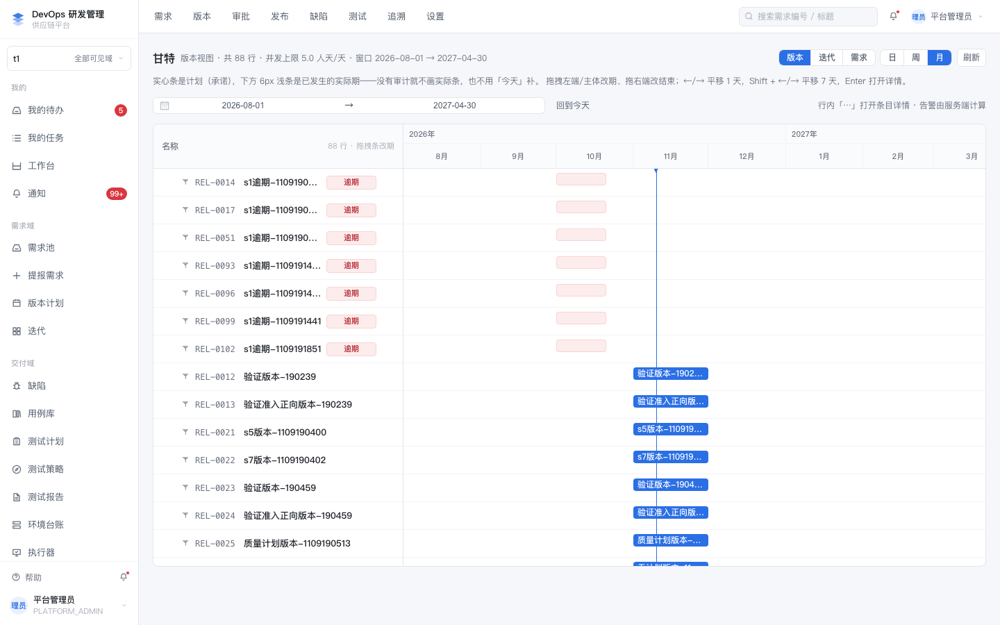<br>甘特：版本/迭代/需求三视图、拖拽改期、逾期标红 | 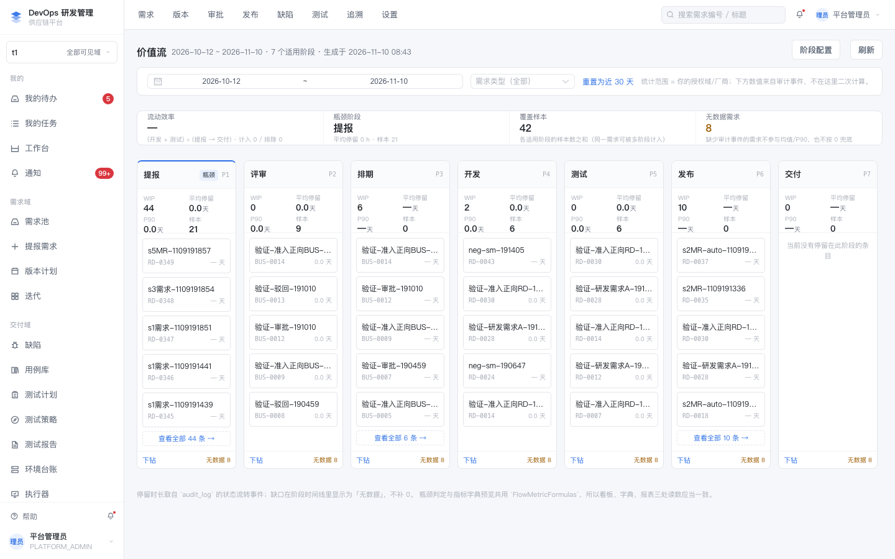<br>价值流：7 阶段 WIP、P90 停留、瓶颈阶段 |
| 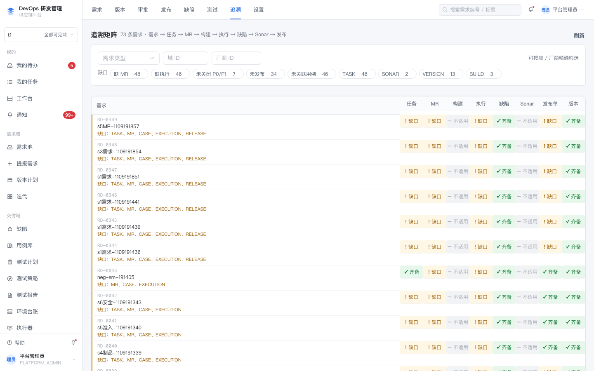<br>追溯矩阵：需求→任务→MR→测试→缺陷→发布 | 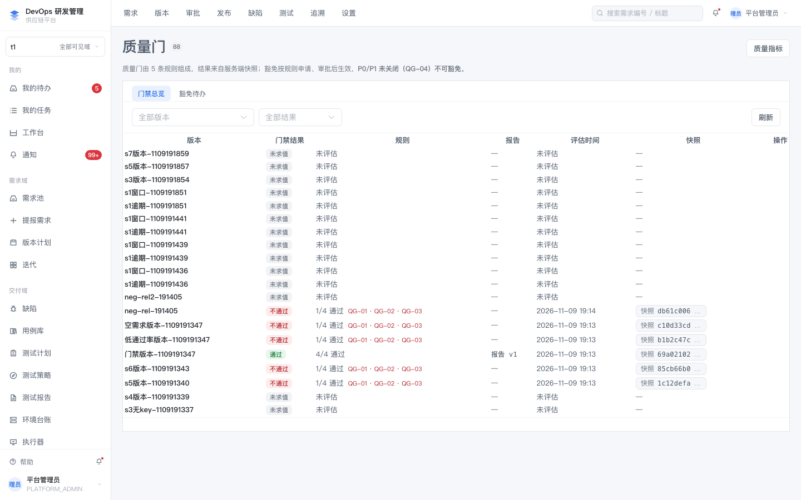<br>质量门总览 |
| 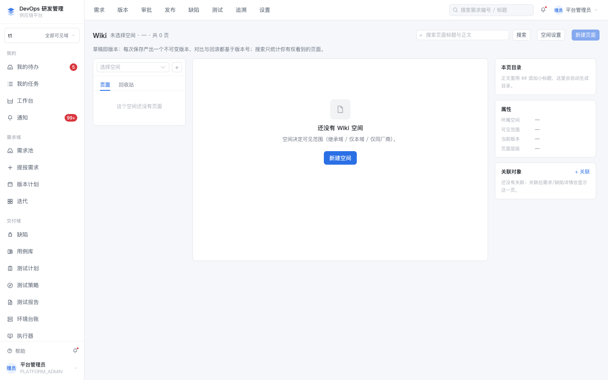<br>Wiki：空间/页面树/版本 | 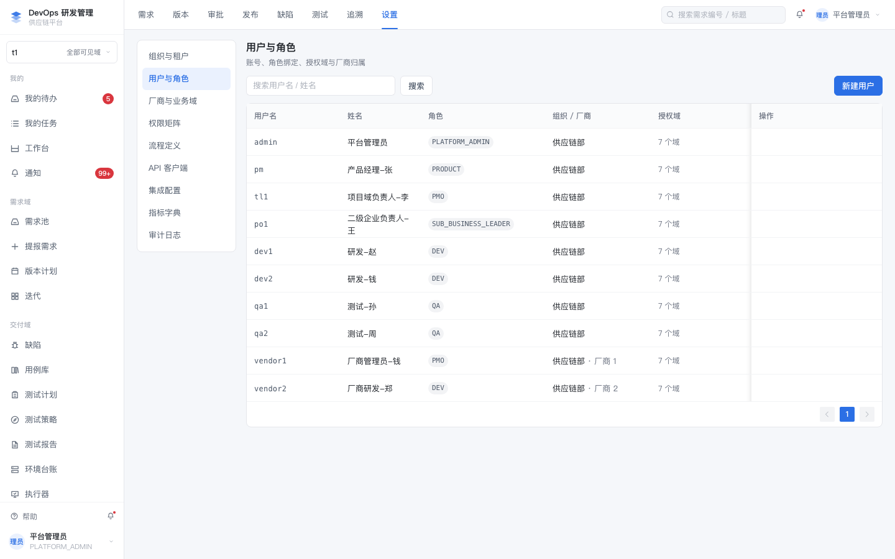<br>用户与角色（10 角色 × 56 功能码） |

### 7.2 业务角色视角

| | |
|---|---|
| 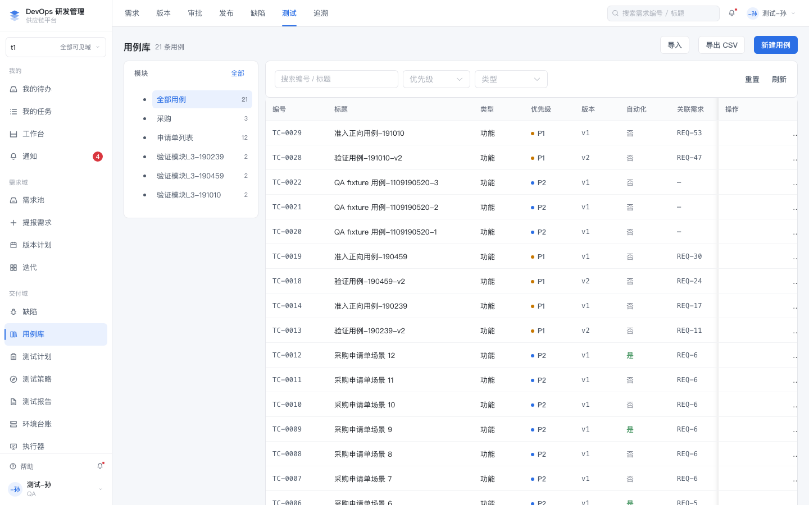<br>qa1：用例库（版本化、评审状态） | 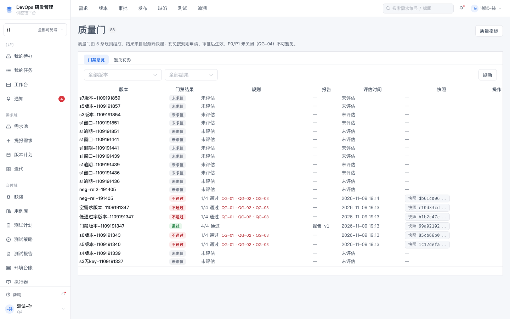<br>qa1：质量门（报告/规则/豁免） |
| 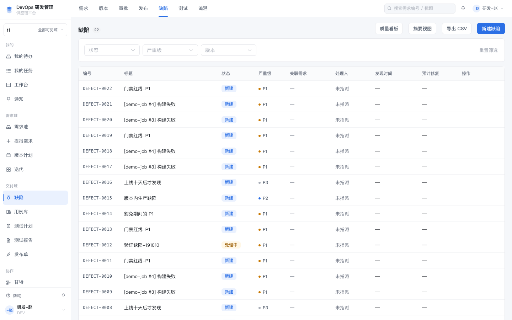<br>dev1：缺陷列表 | 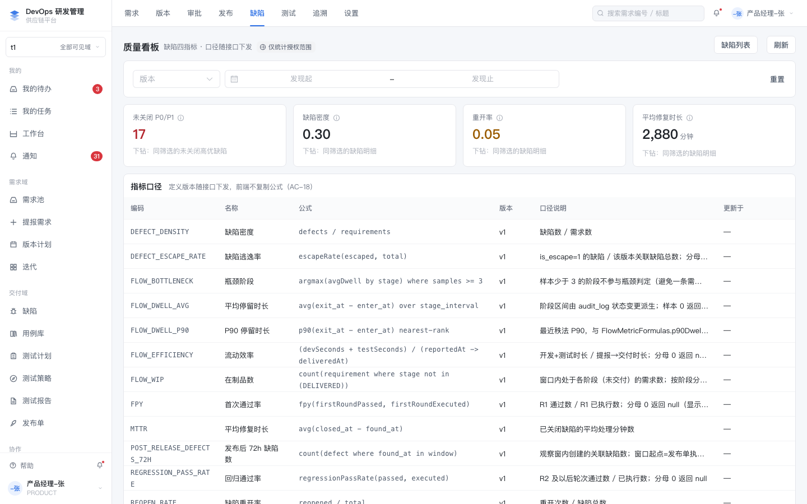<br>pm：缺陷看板 |
| 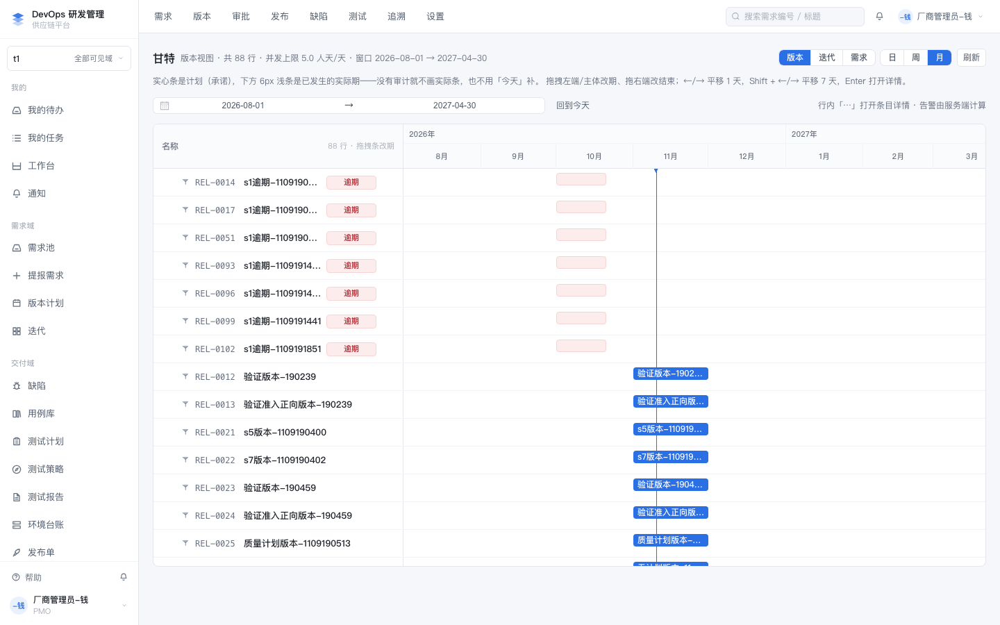<br>vendor1：甘特（只见本厂商承接） | 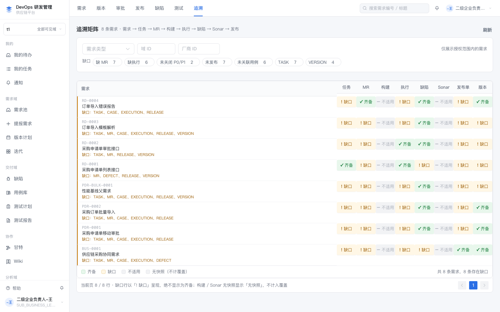<br>po1：追溯矩阵（二级企业视角） |

### 7.3 修复前证据（历史对照）

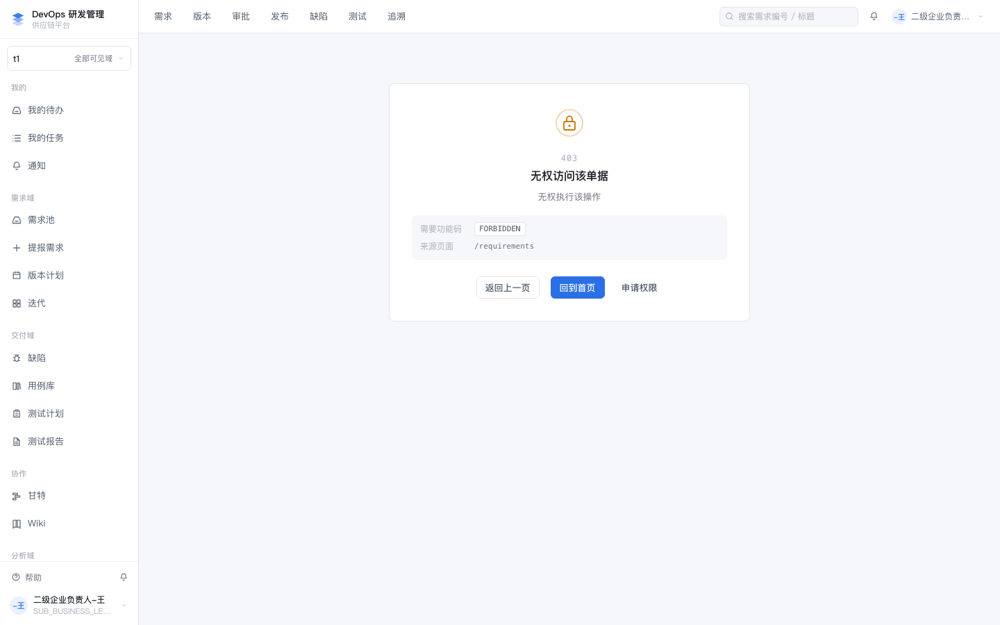

这张图是 r7 **修复前**的故障态，保留作对照：二级企业负责人 `po1` 打开 `/requirements` 直接落到全局 403 页（根因见 §6.1）。修复后 `po1` 打开需求池为 200 且看到 8 条，由 `make access-verify` 的 a2（状态码）与 a4（可见集）持续断言；页面级证据请按 §7.4 现截。

### 7.4 复现命令

```bash
make platform-up
make platform-demo-reset   # 干净演示数据（12 需求 / po1 见 8 / vendor1 见 3 / vendor2 见 0）
"/Applications/Google Chrome.app/Contents/MacOS/Google Chrome" --headless=new --no-sandbox \
  --remote-debugging-port=9222 --user-data-dir=/tmp/chrome-cdp about:blank &
# CDP：Target.createTarget → attachToTarget(flatten) → Page.navigate(/login)
#      → Runtime.evaluate 写 sessionStorage.setItem('devops.session', <登录响应>)
#      → Page.navigate(目标路由) → Page.captureScreenshot
```

## 8. 建议的下一步

1. **P1 收口**：岗位工作台、自助报表 —— 补齐实现或把 `DELIVERED-MODULES.md` 改成"设计已定、未排期"（本轮按 PRD 非目标处理，未动）。
2. **r7 遗留观察项**：`/testcases` 对 `dev1` 可见源自 `DEV` 对 `case:manage` 的 `RESTRICTED`（收窄而非拒绝）。若产品要求 `dev1` 不可见，需改权限矩阵，属独立需求。
3. 之后再做 M8-B（自动化规则引擎、风险与基线、敏感信息扫描）。
