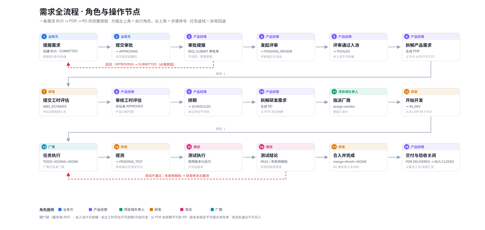

# 需求流程图 · 角色与操作节点

> 一条需求从「业务方提报」到「验收关闭」的完整旅程：**18 个操作节点、8 类角色、8 个硬门禁错误码**。
> 图与表都按当前代码（`main`）的实际状态机与权限矩阵绘制，不是设计稿。



（位图版：`docs/teamflow/diagrams/requirement-flow.png`）

## 1. 十八个操作节点

| # | 角色 | 操作 | 系统接口 / 动作 | 状态变化 | 硬门禁 |
|---|---|---|---|---|---|
| 1 | 业务方 / 二级企业 | 提报业务需求 | `POST /api/req/requirements`（`type=BUS`） | → `SUBMITTED` | 必填：业务域、优先级、期望交付 |
| 2 | 业务方 | 提交审批 | `POST /{id}/actions {action:submit}` | `SUBMITTED` → `APPROVING` | 只能提交或撤回（业务方无审批权） |
| 3 | 产品经理 | 审批提报 | `POST /approvals/tasks/{taskId}/actions {APPROVE/REJECT}` | `APPROVING` → `PENDING_REVIEW` / 驳回回 `SUBMITTED` | 驳回必须填原因，进动态与审计 |
| 4 | 产品经理 | 发起评审 | `POST /{id}/actions {action:review_start}` | 状态不变，生成 `REQ_REVIEW` 审批实例 | 同一需求不允许并行多张评审单 |
| 5 | 产品经理 | 评审通过入池 | `POST /{id}/actions {action:review_pass}` | `PENDING_REVIEW` → `POOLED` | 评审实例必须 `APPROVED`，否则 `409 REVIEW_APPROVAL_REQUIRED` |
| 6 | 产品经理 | 拆解产品需求 | `POST /{id}/decompose {type:PDR}` | 生成 PDR：`PENDING_ANALYSIS` | `409 PARENT_NOT_POOLED`（父 BUS 必须已入池） |
| 7 | 研发 / PMO | 提交工时评估 | `POST /{id}/estimate {estimateDays,note}` | 生成 `WBS_ESTIMATE` 审批单 | 需要 `req:deliver`；产品经理**只审不提** |
| 8 | 产品经理 | 审核工时评估 | `POST /approvals/tasks/{taskId}/actions {APPROVE}` | 评估单 `APPROVED` | 0.5 天精度；驳回需原因 |
| 9 | 产品经理 | 排期 | `POST /{id}/actions {action:schedule}` | PDR：`PENDING_ANALYSIS` → `SCHEDULED` | `409 ESTIMATE_NOT_APPROVED`；人天改动 >±20% 评估单转 `STALE` 即失效 |
| 10 | 产品经理 | 拆解研发需求 | `POST /{id}/decompose {type:RD}` | 生成 RD：`TODO` | `409 PARENT_NOT_SCHEDULED`（父 PDR 须 `SCHEDULED`/`IN_DEV`） |
| 11 | 项目域负责人 | 指派厂商 | `POST /{id}/assign-vendor {vendorId,reason}` | 不改状态，写 `assignee_vendor` | 原因入审计；此后厂商用户才可见 |
| 12 | 研发 | 开始开发 | `POST /{id}/actions {action:start_dev}` | RD：`TODO` → `IN_DEV` | 需评估单 `APPROVED` |
| 13 | 厂商研发 | 任务执行 | `POST /api/deliver/tasks` + `POST /tasks/{id}/move {status}` | RD 状态不变（任务 `TODO→DOING→DONE`） | 厂商只见本厂商承接的任务 |
| 14 | 研发 | 提测 | `POST /{id}/actions {action:submit_test}` | `IN_DEV` → `PENDING_TEST` | 需 `test:quick` 权限 |
| 15 | 测试 | 测试执行 | 测试计划 / 用例执行接口 | 计划内用例逐条记结果 | 执行记录绑**用例版本**，改版不回溯 |
| 16 | 测试 | 测试结论 | `POST /{id}/actions {action:test_pass}`；失败 `POST /api/deliver/defects` | `PENDING_TEST` → `TEST_PASSED` | 失败只能转缺陷并回研发，研发不能自己点通过 |
| 17 | 研发 | 合入并完成 | `actions merge` → `finish`；交付登记 `POST /{id}/deliver {actualDays,mrUrl}` | `TEST_PASSED` → `MERGED` → `DONE` | 前置：测试通过；实际人天与 MR 落库 |
| 18 | 产品经理 | 交付与验收关闭 | PDR `actions deliver` → `accept`；BUS `actions close` | PDR：`IN_DEV`→`DELIVERED`→`ACCEPTED_CLOSED`；BUS：`POOLED`→`CLOSED` | 父需求人天/进度由子需求实时汇总，不可手填 |

## 2. 角色 × 节点矩阵

`●` = 该角色是主操作人；`○` = 可参与（会签/或签、审批人来源）；`—` = 不参与。

| 节点 | 业务方 | 二级企业 | 产品经理 | 项目域负责人/PMO | 研发 | 测试 | 厂商 | 管理层 |
|---|---|---|---|---|---|---|---|---|
| 1–2 提报/提交 | ● | ● | — | — | — | — | — | — |
| 3 审批提报 | — | — | ● | ○ 会签 | — | — | — | — |
| 4–5 评审入池 | — | — | ● | ○ 会签 | — | — | — | ○ |
| 6 拆解 PDR | — | — | ● | ○ | — | — | — | — |
| 7 提交工时评估 | — | — | — | ● | ● | — | — | — |
| 8 审核工时评估 | — | — | ● | ○ | — | — | — | — |
| 9 排期 | — | — | ● | ○ | — | — | — | — |
| 10 拆解 RD | — | — | ● | ○ | — | — | — | — |
| 11 指派厂商 | — | — | — | ● | — | — | — | — |
| 12–14 开发/提测 | — | — | — | — | ● | — | ● 承接 | — |
| 15–16 测试执行/结论 | — | — | — | — | — | ● | — | — |
| 17 合入/交付登记 | — | — | — | ○ | ● | — | ● | — |
| 18 交付/验收关闭 | ○ 验收 | ○ 验收 | ● | ○ | — | — | — | ○ |

## 3. 三类需求的状态机（与代码一致）

**业务需求 BUS**（`platform-contract/.../StateTables.java:58-70`）

```
SUBMITTED --submit--> APPROVING --approve--> PENDING_REVIEW --review_pass--> POOLED --close--> CLOSED
                         |  ^
              reject / withdraw（回 SUBMITTED）
```

**产品需求 PDR**（`StateTables.java:73-77`）

```
PENDING_ANALYSIS --schedule--> SCHEDULED --start_dev--> IN_DEV --deliver--> DELIVERED --accept--> ACCEPTED_CLOSED
```

**研发需求 RD**（`StateTables.java:80-85`）

```
TODO --start_dev--> IN_DEV --submit_test--> PENDING_TEST --test_pass--> TEST_PASSED --merge--> MERGED --finish--> DONE
```

三层父子关系：BUS（业务需求）→ PDR（产品需求）→ RD（研发需求）；子必须挂父，父的人天/进度/完成率由子实时汇总，父自己不可填人天（`409 PARENT_DAYS_READONLY`）。

## 4. 硬门禁清单（服务端 409，不是前端禁用）

| 错误码 | 触发场景 | 实现位置 |
|---|---|---|
| `PARENT_NOT_POOLED` | 父 BUS 未入池就拆解 | `RequirementRules` / `RequirementService.decompose` |
| `PARENT_NOT_SCHEDULED` | 父 PDR 未排期就拆 RD，或直建 RD 的父未排期 | 同上（r23 起含直建 RD 与改父两条写入口） |
| `ESTIMATE_NOT_APPROVED` | 未过工时评估就排期 / 开始开发 | `WbsEstimateService` + `RequirementRules` |
| `ESTIMATE_ALREADY_APPROVED` | 已有生效评估单又重复提交 | `WbsEstimateService.submit` |
| `PARENT_DAYS_READONLY` | 给父需求手填人天 | `RequirementRules.checkDays` |
| `REVIEW_APPROVAL_REQUIRED` | 评审实例未通过就 `review_pass` | `RequirementService.transition` |
| `ILLEGAL_TRANSITION` | 当前状态不允许该动作 | `StateTables` |
| `FORBIDDEN` / `OUT_OF_SCOPE` | 无动作权限 / 需求在数据范围外 | `RequirementActionMatrix` + `PermissionInterceptor` |

发布侧另有一组门禁（`RELEASE_NOT_LOCKED`、`QUALITY_GATE_FAILED`、`PLAN_NOT_APPROVED`、`ADMISSION_FAILED`），属于「需求 → 版本 → 发布」的下半段，见 `docs/teamflow/DEMO-RELEASE-FLOW.md`。

## 5. 两条异常回退（图上的红虚线）

- **审批驳回**：`APPROVING` → `SUBMITTED`，必须填原因；业务方改完可重新提交。
- **测试不通过**：`PENDING_TEST` → 失败转缺陷（`BUG-xxxx`，带用例/版本/需求上下文）→ 研发修复 → 重新提测，缺陷与需求双向可追。

## 6. 这张图的依据

| 依据 | 位置 |
|---|---|
| 状态机 | `platform-contract/src/main/java/com/example/platform/contract/StateTables.java:58-85` |
| 动作与所需权限 | `platform-contract/.../ActionRegistry.java`、`RequirementActionMatrix.java` |
| 门禁判定 | `RequirementRules`、`WbsEstimateService`、`RequirementService.decompose/transition` |
| 角色×页面/动作授权 | `sys_role_permission`（1680 行种子）+ `PermissionService` |
| 实测 | 视频演示同一套流程已跑通（`docs/teamflow/demo-video/demo-roles.mp4`），截图见 `docs/teamflow/demo-shots/flow-*.png` |

> 图是按 18 个**主操作节点**画的主干：会签/或签的具体审批人来源、加签减签、超时催办等分支没有画进来，它们在审批引擎内部，属于节点 3/4/8 的细节。
